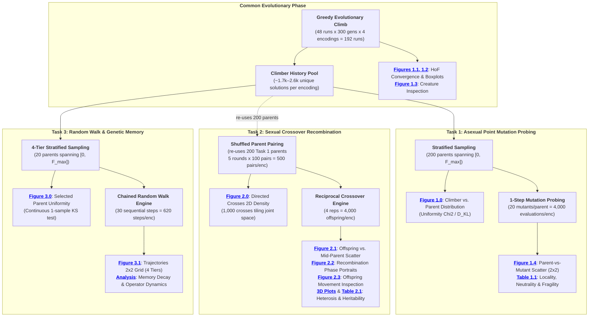

# Assignment 6: Fitness Landscape Exploration

This assignment investigates the topological nature of combinatorial fitness landscapes in evolutionary robotics across four distinct genetic representations ($f_0, f_1, f_4, f_H$) optimizing for rectilinear locomotion speed:

- **[Task 1: Probing Landscape Topology across Various Genetic Encodings (Asexual Mutation)](./task1/report.md)**
  Investigates local mutational landscapes, neutral networks, mutational locality, and evolvability across 1-step mutational neighborhoods.
- **[Task 2: Fitness Landscape Exploration under Crossover Recombination (Sexual Reproduction)](./task2/report.md)**
  Investigates recombinant landscape topology, positive heterosis ($H^+$), realized heritability ($h^2_{\text{cross}}$), and epistatic disruption across 16,000 reciprocal crossover evaluations.
- **[Task 3: Random Walk Fitness Landscape Exploration ("Solution as Memory")](./task3/report.md)**
  Investigates correlation length, mutational fragility, genetic memory decay, and operator dynamics across 30-step sequential chained random walks.

## Objective and Setup

The objective of this assignment is to discover the topological nature of the combinatorial fitness landscape for **net rectilinear locomotion speed** ([`velocity`](https://www.framsticks.com/a/al_params.html#exper-perfcalc)) with neural network control across four fundamentally distinct genetic encodings:

1. [**$f_0$**](https://www.framsticks.com/a/al_geno_f0.html): Direct low-level representation (explicit 3D parts, joints, neurons, and synaptic connections).
2. [**$f_1$**](https://www.framsticks.com/a/al_geno_f1.html): Recurrent tree-developmental encoding with branching and structural repetition.
3. [**$f_4$**](https://www.framsticks.com/a/al_geno_f4.html): Matrix/developmental grammar encoding.
4. [**$f_H$**](https://www.framsticks.com/a/al_geno_fh.html): Handle-based indirect representation (elements assemble and fuse based on vector similarity between evolving numerical handles).

Because combinatorial solution spaces cannot be plotted directly against argument values, the landscape is studied through three complementary experimental protocols:
- **1-Step Mutational Neighborhood Probing ([Task 1](./task1/report.md))**: sampling diverse solutions across the fitness spectrum to characterize local mutational gradients, neutrality, and lethality of mutations.
- **2-Parent Recombination Pairing ([Task 2](./task2/report.md))**: evaluating sexual crossover to measure realized heritability, positive heterosis ($H^+$), and epistatic disruption.
- **30-Step Chained Random Walks ([Task 3](./task3/report.md))**: tracking multi-step stochastic mutational drift across distinct fitness tiers to measure the decoherence rate of evolved genetic memory.

### Simulation Constraints & EA Parameters

- **Optimization Criterion (Fitness)**: `velocity` (net rectilinear displacement speed):
  $$v = \frac{\|\mathbf{x}(T) - \mathbf{x}(0)\|}{T}$$
- **Simulation Environment (`eval-allcriteria.sim;deterministic.sim;sample-period-longest.sim`)**:
  - **Deterministic Physics (`deterministic.sim`)**: Eliminates sensory and mechanical noise (`randinit: 0.0`, `nnoise: 0.0`, `bnoise_vel: 0.0`) with central placement (`placement: 1`), enabling deterministic, noise-free single-trial evaluation (`evalcount: 1`).
  - **Lifespan Mechanism**: Controlled by metabolic energy consumption with starting energy $E_0 = 10\,000.0 \times n$ and idle metabolism $e_\text{meta} = 1.0 \times n$, yielding a constant lifespan of exactly $T = 10\,000$ simulation steps.
  - **Performance Sampling (`sample-period-longest.sim`)**: Configures `perfperiod: 999999`, which exceeds the lifespan, sampling coordinates strictly at birth ($t=0$) and death ($t=10\,000$) to measure rectilinear velocity without periodic sampling overhead.
- **Morphological Limits**:
  - Max parts: `30` (`-max_numparts 30`)
- **EA Parameters**:
  - **Population size**: `100` (`--popsize 100`)
  - **Generations**: `300` (`--generations 300`)
  - **Selection**: Tournament (`size = 5`)
  - **Crossover probability (`pxov`)**: `0.0` (pure asexual mutation-driven climb)
  - **Mutation probability (`pmut`)**: `0.9` (standard Framsticks rate)
  - **Hall of Fame size**: `1`
  - **Replications**: `48` independent runs per representation (2 batches on 24 CPU cores)

### Experiment Design and Workflow

The experimental workflow across Assignment 6 connects three complementary exploration methodologies derived from a unified evolutionary baseline:

1. **Base Evolutionary Phase (Climbing Runs)**:
   - 48 independent runs across 300 generations for each representation ($192$ runs total), logging every monotonically improving Hall of Fame individual.
   - Evaluates macro-level optimization dynamics: convergence confidence curves ([Figure 1.1](./task1/report.md#fig-evolution-mean-curves)), final HoF distributions and run durations ([Figure 1.2](./task1/report.md#fig-evolution-boxplots)), and best-creature morphological inspections ([Figure 1.3](./task1/report.md#fig-best-creature-inspection)).
   - Assembles an aggregated pool of ~1.7k–2.6k unique evolutionary climbers across $[0, F_{\max}]$ per representation.

2. **[Task 1: Asexual Point Mutation Probing](./task1/report.md)**:
   - Samples $S = 200$ diversified parents spanning $[0, F_{\max}]$ using stratified random binning ([Figure 1.0](./task1/report.md#fig-distribution-parents-climbers)).
   - Evaluates $N = 20$ valid 1-step mutants per parent ($4\,000$ mutational evaluations per encoding), retrying invalid individuals to quantify lethality.
   - Characterizes local mutational locality, neutrality, and landscape ruggedness ([Figure 1.4](./task1/report.md#fig-parent-mutant-fitness-scatter-plots) and [Table 1.1](./task1/report.md#table-neighborhood-characteristics)).

3. **[Task 2: Sexual Crossover Recombination](./task2/report.md)**:
   - Re-uses the 200 stratified parents from Task 1, pairing them across 5 independent shuffle rounds to obtain 500 unique parent pairs ($1\,000$ directed crosses tiling the $(P_{\text{base}}, P_{\text{donor}})$ plane, [Figure 2.0](./task2/report.md#fig-parents-distribution)).
   - Evaluates reciprocal directional crosses with 4 replications per direction ($4\,000$ offspring per encoding, $16\,000$ total).
   - Maps recombinant trait transmission, epistatic breakdown, and heterosis ([Figure 2.1](./task2/report.md#fig-crossover-scatter), [Figure 2.2](./task2/report.md#fig-crossover-phase-portrait), [Figure 2.3](./task2/report.md#fig-example-offspring), [3D Interactive Landscapes](./task2/report.md#3d-plots), and [Table 2.1](./task2/report.md#table-crossover-summary)).

4. **[Task 3: Random Walk Fitness Landscape Exploration ("Solution as Memory")](./task3/report.md)**:
   - Samples $N = 20$ stratified parents spanning $[0, F_{\max}]$, partitioned into 4 distinct initial quality tiers ([Figure 3.0](./task3/report.md#fig-parents-uniformity)).
   - Executes 30-step sequential chained random walk mutations ($620$ steps per encoding, $2\,480$ total), rejecting infeasible mutants.
   - Measures genetic memory decoherence, low-fitness basin entrapment, and operator destructiveness across time ([Figure 3.1](./task3/report.md#fig-trajectories-2x2)).
