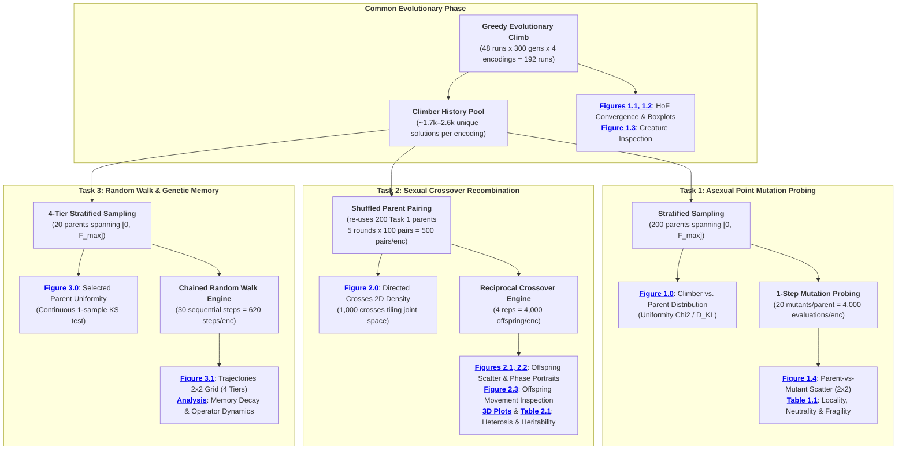

# Assignment 6: Fitness Landscape Exploration

This assignment investigates the topological nature of combinatorial fitness landscapes in evolutionary robotics optimizing for **net rectilinear locomotion [speed](https://www.framsticks.com/a/al_params.html#exper-perfcalc)** across four distinct genetic representations:
- [$f_0$](https://www.framsticks.com/a/al_geno_f0.html) - direct low-level representation (explicit 3D parts, joints, neurons, and synaptic connections).
- [$f_1$](https://www.framsticks.com/a/al_geno_f1.html) - recurrent tree-developmental encoding with branching and structural repetition.
- [$f_4$](https://www.framsticks.com/a/al_geno_f4.html) - matrix/developmental grammar encoding.
- [$f_H$](https://www.framsticks.com/a/al_geno_fh.html) - handle-based indirect representation (elements assemble and fuse based on vector similarity between evolving numerical handles).

## Objective and Setup

Because combinatorial solution spaces cannot be plotted directly against argument values, the landscape is studied through three complementary experiments:
- **1-Step Mutational Neighborhood Probing ([Task 1](./task1/README.md))**: sampling diverse solutions across the fitness spectrum to characterize local mutational gradients, neutrality, and lethality relative to the $y = x$ reference line.
- **2-Parent Recombination Pairing ([Task 2](./task2/README.md))**: evaluating sexual crossover across the 2D Cartesian fitness plane to measure realized heritability ($h^2_{\text{cross}}$), positive heterosis ($H^+$), and epistatic disruption.
- **30-Step Chained Random Walks ([Task 3](./task3/README.md))**: tracking multi-step stochastic mutational drift across distinct fitness tiers to measure the decoherence rate of evolved genetic memory ("solution as memory").

### Simulation Constraints & EA Parameters

- **Optimization Criterion (Fitness)**: `velocity` -net rectilinear displacement speed:

$$v = \frac{\|\mathbf{x}(T) - \mathbf{x}(0)\|}{T}$$

- **Simulation Environment ([`eval-allcriteria.sim;deterministic.sim;sample-period-longest.sim`])**:
  - **Deterministic Physics** ([`deterministic.sim`](../..//Framsticks55/data/deterministic.sim)) eliminates sensory and mechanical noise (`randinit: 0.0`, `nnoise: 0.0`, `bnoise_vel: 0.0`) with central placement (`placement: 1`), enabling deterministic, noise-free single-trial evaluation (`evalcount: 1`).
  - **Lifespan Mechanism** is controlled by metabolic energy consumption with starting energy $E_0 = 10\,000.0 \times n$ and idle metabolism $e_\text{meta} = 1.0 \times n$, yielding a constant lifespan of exactly $T = 10\,000$ simulation steps.
  - **Performance Sampling** ([`sample-period-longest.sim`](../..//Framsticks55/data/sample-period-longest.sim)) configures `perfperiod: 999999`, which exceeds the lifespan, sampling coordinates strictly at birth ($t=0$) and death ($t=10\,000$) to measure rectilinear velocity without periodic sampling overhead.
- **Morphological Limits**:
  - Max parts: `30` (`-max_numparts 30`)
- **EA Parameters**:
  - **Population size**: `100` (`--popsize 100`)
  - **Generations**: `300` (`--generations 300`)
  - **Selection**: Tournament (`size = 5`)
  - **Crossover probability (`pxov`)**: `0.0` (pure asexual mutation-driven climb)
  - **Mutation probability (`pmut`)**: `0.9` (standard Framsticks rate)
  - **Hall of Fame size**: `1`
  - **Replications**: `48` independent runs per representation (2 batches on 24 CPU cores)

### Experiment Design and Workflow

The experimental workflow across Assignment 6 connects three complementary exploration methodologies derived from a unified evolutionary baseline:

- **Base Evolutionary Phase (Climbing Runs)**:
   - 48 independent runs across 300 generations for each representation, logging every monotonically improving Hall of Fame individual.
   - Evaluates macro-level optimization dynamics: convergence confidence curves ([Figure 1.1](./task1/README.md#fig-evolution-mean-curves)), final HoF distributions and run durations ([Figure 1.2](./task1/README.md#fig-evolution-boxplots)), and best-creature morphological inspections ([Figure 1.3](./task1/README.md#fig-best-creature-inspection)).
   - Assembles an aggregated pool of ~1.7k–2.6k unique evolutionary climbers across $[0, F_{\max}]$ per representation.

- **[Task 1](./task1/README.md): Asexual Point Mutation Probing**:
   - Samples $S = 200$ diversified parents spanning $[0, F_{\max}]$ using stratified random binning ([Figure 1.0](./task1/README.md#fig-distribution-parents-climbers)).
   - Evaluates $N = 20$ valid 1-step mutants per parent ($4\,000$ mutational evaluations per encoding), retrying invalid individuals to quantify lethality.
   - Characterizes local mutational locality, neutrality, and landscape ruggedness ([Figure 1.4](./task1/README.md#fig-parent-mutant-fitness-scatter-plots) and [Table 1.1](./task1/README.md#table-neighborhood-characteristics)).

- **[Task 2](./task2/README.md): Sexual Crossover Recombination**:
   - Re-uses the 200 stratified parents from Task 1, pairing them across 5 independent shuffle rounds to obtain 500 unique parent pairs ($1\,000$ directed crosses tiling the $(P_{\text{base}}, P_{\text{donor}})$ plane, [Figure 2.0](./task2/README.md#fig-parents-distribution)).
   - Evaluates reciprocal directional crosses with 4 replications per direction ($4\,000$ offspring per encoding, $16\,000$ total).
   - Maps recombinant trait transmission, epistatic breakdown, and heterosis ([Figure 2.1](./task2/README.md#fig-crossover-scatter), [Figure 2.2](./task2/README.md#fig-crossover-phase-portrait), [Figure 2.3](./task2/README.md#fig-example-offspring), [3D Interactive Landscapes](./task2/README.md#3d-plots), and [Table 2.1](./task2/README.md#table-crossover-summary)).

- **[Task 3](./task3/README.md): Random Walk Fitness Landscape Exploration ("Solution as Memory")**:
   - Samples $N = 20$ stratified parents spanning $[0, F_{\max}]$, partitioned into 4 distinct initial quality tiers ([Figure 3.0](./task3/README.md#fig-parents-uniformity)).
   - Executes 30-step sequential chained random walk mutations, rejecting infeasible mutants.
   - Measures genetic memory decoherence, low-fitness basin entrapment, and operator destructiveness across time ([Figure 3.1](./task3/README.md#fig-trajectories-2x2)).

## Cross-Representation Synthesis: Landscape Topology vs. Evolutionary Efficiency

Comparing the macro-level evolutionary search dynamics ([**Phase 1 convergence, distributions, and variance**](./task1/README.md#results)) with the micro-level topological features (**Tasks 1, 2, and 3**) reveals decisive relationships between search space topology and evolutionary efficiency:

| Genetic Encoding | Search Space Topology | Landscape Shape (Characterized by [mutation](./task1/README.md#quantitative-landscape-metrics), [crossover](./task2/README.md#quantitative-crossover-metrics)) | Evolutionary Efficiency & Dynamics |
| :---: | :--- | :--- | :--- |
| **$f_0$** (Direct) | **Continuous, additive** Euclidean space with modest ruggedness | Moderate locality ($r = 0.55$), **balanced heritability** ($\beta_{\text{base}} \approx \beta_{\text{donor}} \approx 0.16$, $R = 0.28$), lowest crossover lethality (_0.02%_) | **Consistent, steady  climb** without premature stagnation ($0.0101 \pm 0.0045$); smooth parametric tuning of body and brain. |
| **$f_1$** (Recurrent Tree) | Highly localized tree-developmental space with deceptive attractors | **Highest mutational locality** ($r = 0.71$), lowest mutation lethality (_0.17%_), small step size ($\lvert \Delta F\rvert = 0.0022$) -> **smooth landscape**, low heterosis (_0.03%_)| **The High-Locality Paradox**: Lowest mean ($0.0047$) and median ($0.0034$) fitness, along with early flattening of [convergence curves](./task1/README.md#fig-evolution-mean-curves). Excessive locality traps populations in conservative crawl gaits; lack of structural innovation prevents jumping. |
| **$f_4$** (Grammar) | Multi-scale generative grammar with neutral plateaus bounded by cliffs | Highest mutation lethality (_2.01%_), bimodal neighborhood scatter, highest heterosis ($H^+$=0.18%, but _91.7%_ destruction rate) | **The Combinatorial Lottery**: High variance ($\pm 0.0077$), low median ($0.0064$), but [**global champions**](./task1/README.md#fig-best-creature-inspection) ($F_{\max} = 0.0436$, $2\times$ higher than any other). Macro-mutations cross fitness valleys. |
| **$f_H$** (Handle-based) | Metric-threshold Euclidean interaction space with vast neutral networks | **Highest mutation neutrality** (_58.23%_), lowest mutation disruption (_40.73%_), but catastrophic crossover failure ($R = 0.069$, _20.7%_ lethality) | **Exploration via Neutral Drift**: Highest average ($0.0127$) and median ($0.0123$) fitness. Large neutral networks buffer against lethality and enable sequence-space drift to bypass local dead-ends, which is critical in light of scarce beneficial mutations (_<3%_). |

### Key Insights

1. **The Paradox of High Locality ($f_1$)**:
   Intuitively, high mutational locality (smooth landscapes where small genotype changes yield small phenotype/fitness changes) is thought to facilitate evolutionary search. In complex, multi-modal robotics landscapes, however, **excessive locality acts as an evolutionary trap**. In $f_1$, [_67.1%_ of mutations](..//Assignment%205%20-%20Modifying%20topology%20exploration%20path.%20Evolution%20of%20Designs/README.md#table1) alter synaptic weights while suppressing structural morphology alterations (_12.8%_). Consequently, populations readily optimize within the immediate local attractor (fine-tuning conservative crawler gaits), but cannot execute the coordinated macro-structural reorganizations needed to discover high-velocity jumping gaits.

2. **Extensive Neutral Networks as Exploration Highways ($f_H$)**:
   When beneficial mutations are scarce (_1.5% - 3.7%_), neutral mutations (_58.23%_ in $f_H$) act as bridges between disparate basins of attraction. Because handle-based interactions are buffered by Euclidean distance thresholds, mutations can alter latent connectivity rules without degrading mechanical viability. This allows populations under asexual mutation to drift neutrally across sequence space until encountering higher-fitness escape corridors, explaining why $f_H$ achieved the highest median and mean performance.

3. **Macro-Mutational Leaps and Evolvability Ceilings ($f_4$)**:
   In developmental grammar encodings, single rule rewrite mutations alter whole phenotypic sub-structures upon recursive unfolding. While this creates a fragile, high-lethality landscape where most individuals collapse (_91.7%_ destructive crossover, _2.01%_ mutation lethality), rare coordinated mutations enable evolutionary leaps directly into novel gait regimes. Thus, generative developmental encodings maximize peak evolvability ($F_{\max} = 0.0436$) at the expense of search consistency.

## Evaluating Global Convexity ("Big Valley" Hypothesis)

In continuous optimization, convexity guarantees that any local gradient points toward the global optimum. In combinatorial fitness landscapes, this property is formalized as the **"Big Valley" hypothesis** (Boese et al., 1994; Reeves, 1999): local optima are not randomly distributed throughout the search space, but instead cluster around a central global basin, with their distance to the global optimum negatively correlated with their fitness.

### Methodologies for Evaluating Global Convexity

To empirically evaluate the property of global convexity on a sample of solutions $S = \{x_1, x_2, \dots, x_N\}$ with fitness $F(x_i)$, the following methodologies can be applied:

0. **Metric Distance Space Formulation**.
Convexity analysis requires defining a valid metric distance $d(x_i, x_j)$ between solutions:
   - **Genotypic Distance**:
      - For graph/tree encodings ($f_0, f_1$), structural distance can be evaluated via **graph spectral distance** (eigenvalue differences of normalized Laplacian matrices $\mathbf{L} = \mathbf{D}^{-1/2}(\mathbf{D} - \mathbf{A})\mathbf{D}^{-1/2}$), providing a permutation-invariant metric of body/brain topology.
      - Direct encodings ($f_0$): Normalized Levenshtein or token alignment distance over graph definitions.
      - Tree encodings ($f_1$): Zhang-Shasha Tree Edit Distance (TED) over morphological and neural tree hierarchies.
      - Grammar encodings ($f_4$): String edit distance over developmental production rules.
      - Handle encodings ($f_H$): Earth Mover's (Wasserstein) or Hungarian matching distance between 3D coordinate handle sets.
   - **Phenotypic / Behavioral Distance**:
      - Morphological feature vector distance (Euclidean distance over part counts, mass distribution, center-of-mass elevation, and actuator joint limits).

1. **Fitness Distance Correlation (FDC)** quantifies whether fitness provides a globally directed signal pointing toward the optimum:
   1. Identify the best-known solution $x^* = \arg\max_{x \in S} F(x)$.
   2. Compute the metric distance $d(x_i, x^*)$ for every sampled solution $x_i \in S$.
   3. Compute the Pearson correlation coefficient between fitness and distance:
      $$r_{\text{FDC}} = \frac{\sum_{i=1}^N (F(x_i) - \bar{F})(d(x_i, x^*) - \bar{d})}{(N-1) s_F s_d}$$
   - **Interpretation**:
      - $r_{\text{FDC}} \approx -1.0 \implies$ **Strong Global Convexity ("Big Valley")**. As solutions approach the optimum in search space, fitness monotonically increases.
      - $r_{\text{FDC}} \approx 0.0 \implies$ **Flat / Uncorrelated Global Structure**. Peaks are isolated needles in an uninformative landscape.
      - $r_{\text{FDC}} > 0.0 \implies$ **Deceptive Landscape**. Gradient information leads search away from the global optimum.

2. **Elite Subset Dispersion** (Convergent Funnel Analysis).
When the true global optimum $x^*$ is unknown:
   1. Partition the sample into fitness tiers $S_{\text{top}}, S_{\text{mid}}, S_{\text{low}}$ (as in [Task 3](./task3/README.md#fig-parents-uniformity)).
   2. Compute the average intra-tier pairwise distance:
   
   $$\bar{D}(S_k) = \frac{2}{|S_k|(|S_k|-1)} \sum_{x_i, x_j \in S_k, i < j} d(x_i, x_j)$$

   3. **Convexity Criterion**:

   $$\bar{D}(S_{\text{top}}) \ll \bar{D}(S_{\text{mid}}) \ll \bar{D}(S_{\text{low}})$$
   
      - In a globally convex landscape, the dispersion contracts monotonically as fitness increases, forming a convergent funnel. If high-fitness solutions remain as dispersed across the search space as low-fitness solutions ($\bar{D}(S_{\text{top}}) \approx \bar{D}(S_{\text{low}})$), the landscape consists of multiple disparate attraction basins.

3. **Recombination Defect / Jensen's Inequality Test**.
In continuous calculus, convexity of a maximization objective requires $f(\frac{x + y}{2}) \ge \frac{f(x) + f(y)}{2}$. In discrete evolutionary landscapes, crossover acts as stochastic midpoint interpolation:
   1. For pairs $(P_1, P_2) \in S_{\text{top}} \times S_{\text{top}}$, evaluate recombinant offspring $O = \text{crossOver}(P_1, P_2)$.
   2. Measure the **recombination convexity defect**:

      $$\Delta_{\text{conv}} = F(O) - \frac{F(P_1) + F(P_2)}{2}$$
      
   3. **Empirical Finding from [Task 2](./task2/README.md#table-crossover-summary)**:
      Across all four genetic encodings, crossover between independently evolved parents resulted in **over _73% - 91%_ destructive collapse**, with offspring fitness collapsing toward zero ($F(O) \approx 0$) and positive heterosis virtually absent ($H^+ \le$ _0.18%_). This empirically demonstrates that the [locomotion fitness](#objective-and-setup) landscape in Framsticks **violates global convexity**: high-fitness solutions occupy narrow, isolated ridges separated by deep non-viable chasms (severe outbreeding depression).

4. To further elaborate the previous idea, one could use **Directional Secant Probing (Geometric Crossover & Spectral Distance)**:
   - By viewing crossover as a form of geometric crossover sampling the metric segment between $P_1$ and $P_2$, generating multiple recombinant offspring traces the 1D **fitness profile along that secant**.
   - The parental separation $d(P_1, P_2)$ controls the probe scale: small distances test local hill curvature, while **large inter-tier distances test the global funnel**. As revealed in [Task 2 Figure 2](./task2/README.md#fig-crossover-phase-portrait), distant pairings collapse immediately to zero, formally rejecting global convexity and confirming the landscape consists of an expansive flat floor with isolated, steep towers.
   - Running constrained random walks that mutate strictly one property (e.g., stick addition/removal vs. neural weights) **inspects which individual orthogonal dimensions destroy convexity**.

### Parallels: [Classical Combinatorial Optimization](../../../Combinatorial%20Optimization/final_report.pdf) vs. Framsticks Robotics Landscapes

In classical combinatorial optimization (e.g., TSP, QAP, graph partitioning), fitness landscapes are defined over discrete metric spaces (permutation graphs, Hamming hypercubes). Global convexity - the "Big Valley" landscape structure - implies that local optima share sub-structural building blocks and cluster around a central global basin. In such spaces, crossover operates as **geometric semantic interpolation**: offspring lie on metric segments between parents, and secant probing across parent pairs preserves additive schemata. Evolutionary efficiency in these landscapes relies on **correlated fitness-distance gradients** (high negative FDC), where local hill-climbing and recombination smoothly guide populations toward the global optimum.

Empirical findings across the four Framsticks encodings reveal a fundamentally different topology: the landscape for net rectilinear displacement speed is **globally non-convex and predominantly flat**, punctuated by isolated, needle-like towers. Because robotics locomotion requires tight kinematic-neural co-adaptation, crossing parents from different fitness tiers or lineages triggers catastrophic epistatic breakdown ($ \to 0$ in _73%..92%_ of crosses, [Task 2 Figure 2](./task2/README.md#fig-crossover-phase-portrait)), rejecting the existence of a single shared funnel. Instead, evolutionary efficiency is governed by encoding-specific search topologies (see [Table](#table-encodings-summary) above).

| Landscape Property | Classical Combinatorial Optimization (e.g., TSP / NK) | Framsticks 3D Evolutionary Robotics (Locomotion) |
| :--- | :--- | :--- |
| **Search Space Metric** | Permutation swap distance, Hamming distance, 2-opt neighborhoods | Graph spectral distance ($f_0$), Tree Edit Distance ($f_1$), String grammar edit ($f_4$), Handle Wasserstein metric ($f_H$) |
| **Global Convexity / "Big Valley"** | Present in well-behaved benchmarks; local optima share building blocks clustered near $x^*$ | **Absent (Globally non-convex)**; expansive flat plain ($F \approx 0$) with steep, isolated towers separated by lethal chasms |
| **Crossover Operator Role** | Geometric interpolation; preserves shared schemata / intermediate sub-tours | **Predominantly destructive** (_73%-92%_ collapse); severe outbreeding depression from broken kinematic-neural synergy |
| **Mutational Step Nature** | Parametric 1-step moves (e.g., 2-opt edge inversion) preserve locality | Highly heterogeneous: continuous tuning ($f_0$), neural-only bias ($f_1$), macro-structural unfolds ($f_4$), neutral shifts ($f_H$) |
| **Neutrality & Drift** | Often minimal or treated as uninformative plateaus | **Primary evolutionary driver in $f_H$**: _58%_ neutral rate allows safe drift through corridors when beneficial mutations are scarce ($<3%$) |
| **Evolutionary Failure Modes** | Deception (local optima leading away from $x^*$) | **High-locality traps** in $f_1$ (crawlers cannot leap to jumpers) vs. **combinatorial fragility** in $f_4$ (_91.7%_ destructive recombination) |