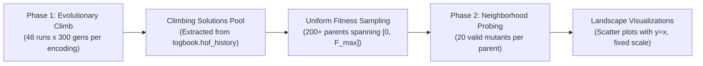

# Assignment 6: Fitness Landscape Exploration

This assignment investigates the topological nature of combinatorial fitness landscapes in evolutionary robotics across four distinct genetic representations ($f_0, f_1, f_4, f_H$) optimizing for rectilinear locomotion speed:

- **[Task 1: Probing Landscape Topology across Various Genetic Encodings (Asexual Mutation)](./task1/README.md)**
  Investigates local mutational landscapes, neutral networks, mutational locality, and evolvability across 1-step mutational neighborhoods.
- **[Task 2: Fitness Landscape Exploration under Crossover Recombination (Sexual Reproduction)](./task2/README.md)**
  Investigates recombinant landscape topology, positive heterosis ($H^+$), realized heritability ($h^2_{\text{cross}}$), and epistatic disruption across 16,000 reciprocal crossover evaluations.

## [Task 1 Overview](./task1/README.md)

### Objective and Setup

The objective of this assignment is to discover the topological nature of the combinatorial fitness landscape—its ruggedness, neutrality, mutational locality, and evolvability—for **net rectilinear locomotion speed** ([`velocity`](https://www.framsticks.com/a/al_params.html#exper-perfcalc)) with neural network control across four fundamentally distinct genetic encodings:

1. [**$f_0$**](https://www.framsticks.com/a/al_geno_f0.html): Direct low-level representation (explicit 3D parts, joints, neurons, and synaptic connections).
2. [**$f_1$**](https://www.framsticks.com/a/al_geno_f1.html): Recurrent tree-developmental encoding with branching and structural repetition.
3. [**$f_4$**](https://www.framsticks.com/a/al_geno_f4.html): Matrix/developmental grammar encoding.
4. [**$f_H$**](https://www.framsticks.com/a/al_geno_fh.html): Handle-based indirect representation (elements assemble and fuse based on vector similarity between evolving numerical handles).

Because combinatorial solution spaces cannot be plotted directly against argument values, we study the landscape through **parent-offspring neighborhood probing**: sampling diverse solutions across the fitness spectrum and analyzing the distribution of their 1-step mutational neighbors relative to the $y = x$ identity line.

### Simulation Constraints & EA Parameters

- **Optimization Criterion (Fitness)**: `velocity` (net rectilinear displacement speed):
  $$v = \frac{\|\mathbf{x}(T) - \mathbf{x}(0)\|}{T}$$
- **Simulation Environment (`eval-allcriteria.sim;deterministic.sim;sample-period-longest.sim`)**:
  - **Deterministic Physics (`deterministic.sim`)**: Eliminates sensory and mechanical noise (`randinit: 0.0`, `nnoise: 0.0`, `bnoise_vel: 0.0`) with central placement (`placement: 1`), enabling deterministic, noise-free single-trial evaluation (`evalcount: 1`).
  - **Lifespan Mechanism**: Controlled by metabolic energy consumption with starting energy $E_0 = 10\,000.0 \times n$ and idle metabolism $e_\text{meta} = 1.0 \times n$, yielding a constant lifespan of exactly $T = 10\,000$ simulation steps.
  - **Performance Sampling (`sample-period-longest.sim`)**: Configures `perfperiod: 999999`, which exceeds the lifespan, sampling coordinates strictly at birth ($t=0$) and death ($t=10\,000$) to measure rectilinear velocity without periodic sampling overhead.
- **Morphological Limits**:
  - Max parts: `30` (`-max_numparts 30`)
- **EA Parameters**:
  - **Population size**: `100` (`--popsize 100`)
  - **Generations**: `300` (`--generations 300`)
  - **Selection**: Tournament (`size = 5`)
  - **Crossover probability (`pxov`)**: `0.0` (pure asexual mutation-driven climb)
  - **Mutation probability (`pmut`)**: `0.9` (standard Framsticks rate)
  - **Hall of Fame size**: `1`
  - **Replications**: `48` independent runs per representation (2 batches on 24 CPU cores)

### Two-Phase Experimental Protocol

#### Phase 1: Evolutionary Climb & Diverse Sampling
- **Relatively Greedy & Fast Evolution**: Tournament selection ($k=5$), high population size ($N=100$), pure mutation ($p_\text{mut}=0.90, p_\text{xov}=0.0$), and deterministic physics drive a rapid, focused climb from simple initial seeds (`//0`, `X`, `/*4*/X`, `//H...`) to local optima.
- **Continuous Logging**: Every improvement in the single-individual Hall of Fame is recorded at each generation in `logbook.hof_history` and serialized inside `stats/<timestamp>/<hof_base>.logbook.pkl`.
- **Uniform Fitness Binning**: Across the 48 runs for each encoding, candidate climbers are filtered and sampled along an evenly spaced fitness grid to select $S \ge 200$ diversified parent solutions spanning the full range $[0, F_{\max}]$ without gaps.

#### Phase 2: Mutational Neighborhood Probing
- **Mutant Generation**: For each of the $\ge 200$ sampled parents $P$, $N = 20$ valid 1-step mutational neighbors are generated via Framsticks mutation operators.
- **Infeasibility Filtering**: Invalid or broken genotypes (`fitness == FITNESS_VALUE_INFEASIBLE_SOLUTION`) are rejected and retried (up to 20 attempts per mutant), recording retry counts to quantify the **lethality / fragility rate** of each encoding.
- **Evaluation**: Each mutant $m$ is evaluated under the identical simulation settings, recording $(F(P), F(m))$.

### Evaluation Metrics & Visualizations

1. **Parent-vs-Mutant Scatter Plots**:
   - **X-axis**: Parent Fitness $F(P)$
   - **Y-axis**: Mutant Fitness $F(m)$
   - **Reference Line**: Red diagonal $y = x$:
     - Above $y = x$: Beneficial mutants ($F(m) > F(P)$)
     - Below $y = x$: Deleterious mutants ($F(m) < F(P)$)
     - Along $y = x$: Neutral mutants ($F(m) \approx F(P)$)
   - **Fixed Axes Scale**: Strictly identical $[0, F_{\max}^{\text{global}}]$ on both axes across all four representations for unbiased visual comparison.
2. **Quantitative Metrics**:
   - **Improvement Rate**: Percentage of mutants that outperform their parent ($\% \text{ improved}$).
   - **Neutrality Rate**: Percentage of mutants maintaining parent performance ($\pm 10^{-6}$).
   - **Deleterious & Lethality Rate**: Frequency of performance drops and invalid mutations.
   - **Fitness Correlation & Variance**: Spread $\sigma(F(m) - F(P))$ as a function of parent fitness $F(P)$.
