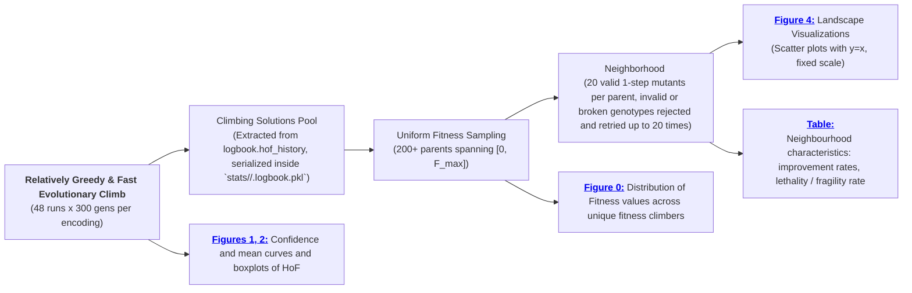

# Assignment 6: Fitness Landscape Exploration
## Task 1: Probing Landscape Topology across Various Genetic Encodings

### Objective and Setup

The objective of this task is to discover the topological nature of the combinatorial fitness landscape - its ruggedness, neutrality, mutational locality, and evolvability - for **net rectilinear locomotion speed** ([`velocity`](https://www.framsticks.com/a/al_params.html#exper-perfcalc)) with neural network control across four distinct genetic encodings:

- [**$f_0$**](https://www.framsticks.com/a/al_geno_f0.html) - direct low-level representation (explicit 3D parts, joints, neurons, and synaptic connections).
- [**$f_1$**](https://www.framsticks.com/a/al_geno_f1.html) - recurrent tree-developmental encoding with branching and structural repetition.
- [**$f_4$**](https://www.framsticks.com/a/al_geno_f4.html) - matrix/developmental grammar encoding.
- [**$f_H$**](https://www.framsticks.com/a/al_geno_fh.html) - handle-based indirect representation (elements assemble and fuse based on vector similarity between evolving numerical handles).

Because combinatorial solution spaces cannot be plotted directly against argument values, the landscape is studied through **parent-offspring neighborhood probing**: sampling diverse solutions across the fitness spectrum and analyzing the distribution of their 1-step mutational neighbors relative to the $y = x$ reference line.

### Experiment design 

First, 48 parallel runs of 300 generations with population size 100 were executed for each representation, while [only improving solutions were recorded to HoF of size 1](../../../scripts/FramsticksEvolutionScheduled.py#L99) (thus only monotonic climbing paths were recorded - in total 48 paths per encoding). Genotypes and fitness values of each HoF update were recorded to `./results/landscape/hof_history_*.csv` (one file per run). The results of evolution are presented on [Figures 1 and 2](#fig-evolution-mean-curves).

Second, the results were [aggregated](../../../scripts/analyze_fitness_landscape.py#L85) and infeasible/duplicate solutions were filtered out, yielding in total ~1.7-2.6k values per each encoding (e.g. there were around 30-60 improving solutions per run).

Third, 200 solutions were selected from each pool using stratified random binning across the fitness interval $[0, F_{\text{max}}]$ ($n_{\text{bins}} = \lfloor \sqrt{200} \rfloor = 14$ equal-width bins with $k \le \lceil 200/14 \rceil = 15$ samples per bin). The uniformity is evaluated on [Figure 0](#fig-distribution-parents-climbers). _Note: Genotypic diversity was not explicitly controlled: in high-density regions of the sample distribution solutions are chosen randomly, which inherently promotes diversity; while in low-density regions (e.g. in the case of the intermediate trajectories of the two lottery winners in_ $f_4$ _) the only available solutions could provide only scarce diversity._

Fourth, for each of these 200 solutions, 20 unique 1-step mutants were generated. If a mutant was invalid or identical to the parent, it was regenerated up to 20 times. This resulted in a total of 4000 pairs of (parent, mutant) solutions for each representation. Finally, aggregated statistics for metrics such as fitness gain, improvement rate and other metrics were computed for each encoding, which are summarized in [Table 1](#table-neighborhood-characteristics) and visualized on [Figure 4](#fig-parent-mutant-fitness-scatter-plots).

  
   

_**Figure 0**: Empirical distribution of all unique evolutionary climbers extracted from Phase 1 history (shaded histogram and continuous KDE curve) versus the distribution of the 200 selected parent solutions (red dashed step count across 14 stratified equal-width bins): uniformity of the distribution of selected parents across fitness values is evaluated using_ $\chi^2$\-_test (_ $\chi^2$ _statistic, p-value, and Kullback-Leibler divergence_ $D_{\text{KL}}$ _in nats), with marginal horizontal quartile diagrams (median and IQR)._ 
_Note: The distribution of original fitness values is naturally right-skewed. Quasi-uniform distribution of 200 selected solutions across fitness values were obtained in case of three representations_ ($D_{KL}< 0.105$), _while for_ $f_4$ _the distribution is highly non-uniform due to selection of two high-performing individuals' intermediate genomes with final fitness values around 0.03 and 0.04 (see [Figures 2](#fig-evolution-boxplots) and [3](#fig-best-creature-inspection))._

### Results

48 independent evolutionary runs of 300 generations with population size 100 were executed for each representation (192 total runs across 24 CPU cores). The table and figures below summarize the optimization performance metrics across the four encodings:

| Representation | Mean Best Fitness $\pm$ Std | Median Fitness | Max Best Fitness | Mean Run Duration |
| :---: | :---: | :---: | :---: | :---: |
| **$f_0$** | **0.010111** $\pm$ 0.004524 | 0.009306 | 0.023337 | 1243.6 s |
| **$f_1$** | 0.004749 $\pm$ 0.004117 | 0.003352 | 0.016334 | 1202.9 s |
| **$f_4$** | 0.008103 $\pm$ 0.007711 | 0.006353 | **0.043587** | 1168.1 s |
| **$f_H$** | **0.012749** $\pm$ 0.004798 | **0.012263** | 0.028365 | 1369.3 s |

  
   
  <em>Figure 1: Evolutionary convergence curves showing mean best fitness and its confidence interval across 300 generations for all four encodings.</em>

  
   
  <em>Figure 2: Distribution of final Hall of Fame fitness (left) and computational run duration per experiment in seconds (right) across 48 runs per representation.</em>

  
   

  _Figure 3a: Inspection of functioning of [the best creature](./runs/2026-10-24_185840/gens/HoF-f4-37.gen). The left side depicts the moment of jumping and lifting from the ground by extending creature's leg, two limbs on the right are used as stabilizing torso. The right side depicts creature's redundant neurons and one active neural arc: gyroscope -> bending muscle._

  
   

  _Figure 3b: Inspection of functioning of [the second best creature](./runs/2026-10-24_185840/gens/HoF-f4-28.gen). Mechanics and neural description coincide with the best creature._

### Fitness Landscape Probing Results

$S = 200$ diversified parent solutions per encoding were selected from the climber history pool by matching an equidistant 200-point target grid spanning $[F_{\min}, F_{\max}^{(enc)}]$ to the closest unique solution without replacement, where $F_{\max}^{(enc)}$ is the maximum fitness achieved by the given encoding across all runs.

Each selected parent was then probed by generating $N = 20$ valid 1-step mutants (rejecting infeasible configurations and generating a new mutant until a valid one is generated), producing in total $4\,000$ mutational evaluations per each format.

  
   

  _Figure 4: Comparative parent-vs-mutant fitness landscape scatter plots for all four representations plotted on a globally unified fixed scale_ $[0, 0.0458]$ _with the_ $y = x$ _neutrality diagonal. Gray points indicate mutants that were obtained from parents with final fitness outliers (see [Figure 2: HoF fitness](#fig-evolution-boxplots)). For instance, [two outliers](#fig-best-creature-inspection) in_ $f4$ _representation achieve fitness above_ $0.034$ _, shading thus indicates evolutionary climbing paths resulting from the combinatorial lottery._

#### Isolating the Influence of Outliers

To assess the influence of outliers on the conclusions, producing an additional set of figures is unnecessary: the same insights can be drawn directly from the existing plots. If outlier runs are excluded from the pool from which parents are sampled, the maximum fitness for each representation contracts to the rightmost edge of the colored plume on each subplot in [Figure 4](#fig-parent-mutant-fitness-scatter-plots). Sampling 200 parents within this reduced interval would simply populate the same region more densely, mirroring the colored clusters already displayed. Similarly, the uniform parent step distribution would scale proportionally to this lower maximum while maintaining its flat profile ([Figure 0](#fig-distribution-parents-climbers)). Thus, the existing dataset and color-coded separation sufficiently isolate the effect of outliers.

_Note: motivation for isolating the effect of outliers is to prevent possible effects of "lottery winners" on the overall climbing (e.g. due to chance their trajectory could generate more beneficial mutations than average, and if we include them in the parent pool for landscape probing, we could overestimate the overall potential of a given representation)._

#### Quantitative Landscape Metrics

Mutant performance relative to the parent solution is partitioned into three mutually exclusive categories based on the fitness delta $\Delta F = F(m) - F(P)$ with a numerical tolerance threshold $\epsilon = 10^{-6}$ depending on whether $\Delta F \ge \epsilon$ (better mutants), $|\Delta F| < \epsilon $ (neutral mutants) or $\Delta F \le -\epsilon$ (worse mutants).

The tolerance $\epsilon = 10^{-6}$ is chosen to prevent infinitesimal floating-point fluctuations or minor contact timing variations in continuous physics from being falsely classified as improvements or degradations, ensuring that only numerically robust changes are registered.

The table below reports the complete quantitative neighborhood characteristics with and without outlying evolutionary paths.

| Representation   |  Better ($y > x$)   | Neutral ($y \approx x$)   | Worse ($y < x$)   |   Pearson $r$ | Lethality Rate   | Max Parent Fitness   | Max Mutant Fitness   |
|:-----------------|:-----------------|----------:|:----------|:-------------------|:--------------------------|:------------------|--------------:|
| **f0**           | 114 (2.85%)        | 1,505 (37.62%)            | 2,407 (60.17%)    |        0.5526 | 0.47%            | 0.023337           | 0.023337           |
| No outliers          | 101 (2.95%)        | 1,284 (37.54%)            | 2,061 (60.26%)    |        0.5256 | 0.49%            | 0.018528           | 0.018528           |
| **f1**           | 100 (2.50%)        | 1,748 (43.70%)            | 2,162 (54.05%)    |        0.7085 | 0.17%            | 0.016334           | 0.016334           |
| No outliers           | 48 (2.26%)         | 928 (43.77%)              | 1,154 (54.43%)    |        0.7284 | 0.14%            | 0.010705           | 0.010705           |
| **f4**           | 148 (3.70%)        | 1,410 (35.25%)            | 2,473 (61.82%)    |        0.6039 | 2.01%            | 0.043587           | 0.043587           |
| No outliers           | 116 (4.30%)        | 983 (36.41%)              | 1,629 (60.33%)    |        0.5862 | 2.60%            | 0.015195           | 0.015195           |
| **fH**           | 60 (1.50%)         | 2,329 (58.23%)            | 1,629 (40.73%)    |        0.6047 | 0.92%            | 0.028365           | 0.028365           |
| No outliers           | 60 (1.62%)         | 2,221 (60.03%)            | 1,437 (38.84%)    |        0.6146 | 0.99%            | 0.024326           | 0.024326           |

### Comparison of Representations

- **Indirect handle-based representation** $f_H$ is the most consistent strategy with [peak average](#fig-evolution-mean-curves) and [median](#fig-evolution-boxplots) performance:
  - Mean fitness is $0.012749$ and median is $0.012263$. Its climb is steady and sustained throughout the entire 300 generations, with low variance across seeds: _60%_ of all mutations (`fH_mut_handle` + `fH_mut_property` in [`eval-allcriteria.sim`](..//..//..//Framsticks55/data/eval-allcriteria.sim)) are continuous (Gaussian centered at previous value) coordinate/parameter adjustments, designed to provide minimal numerical change, frequently leaving cluster connectivity unchanged and shielding phenotypes from catastrophic breakdown (**lowest worse rate, 40.73%**).

  - **Extreme phenotypic buffering (58.23% neutrality)** appears as an intensely saturated line along $y = x$ on [Figure 4](#fig-parent-mutant-fitness-scatter-plots), caused by elements linking via spatial proximity between abstract coordinate handles: because elements connect only when handles are within a distance threshold, coordinate shifts often don't alter the topology threshold graph, explaining _58.23%_ neutrality rate and low-variance ascent.

  - While the immediate 1-step improvement rate is the lowest ($1.50\%$), populations **drift neutrally** across high-dimensional plateaus without falling off peaks, eventually discovering portals to higher fitness levels. This sustained neutral exploration yields the highest consistency (mean $0.012749$) and reliable rank preservation ($r = 0.6047$, $0.6146$ without outliers).

- **Direct Low-Level Encoding** ($f_0$) is most mutationally beneficial, evolvable strategy:
  - **$f_0$ provides smooth and predictable ascent**. Direct representation demonstrates intermediate performance (mean $0.010111$, peak $0.023337$) with balanced variance, due to continuous/parametric adjustements (_64%_ of mutations).
  - **High Improvement Rate (2.85%, 2.95% without outliers)**. Direct encoding of parts, coordinates, and synaptic weights provides unconstrained parametric control, creating smooth, continuous slopes.
  - **Balanced Locality with Exploratory Variance**. Pearson correlation ($r = 0.5526$, $0.5256$ without outliers) reflects moderate mutational variance.
  - Harmful mutations degrade performance progressively rather than collapsing to zero, indicating accessible upward gradients.

- **Developmental Grammar** ($f_4$) - volatile strategy with macro-mutations:
  - **$f_4$ achieves global peak with high variance**. While $f_4$ has a lower median ($0.006353$), its developmental grammar rules unlocked extraordinary locomotion velocity ($F_{\max} = 0.043587$ and the second best result $0.034267$). The high standard deviation ($\pm 0.007711$) reflects the combinatorial lottery of grammar evolution: many runs settle in mediocre local attractors, but successful runs discover coordinated modular gaits. Two lottery "winners" are depicted on [Figures 3a, b](#fig-best-creature-inspection).

  - **Bimodal Scatter Distribution**: Points in the upper fitness tier ($F(P) > 0.012$, [Figure 4](#fig-parent-mutant-fitness-scatter-plots)) either maintain velocity along $y = x$ or collapse steeply toward $y = 0$.

  - **Repetition operator** `#NUM(...)`, provided by the grammar, allows for modular repetition of genotype fragments, which helps with evolving complicated structures, this proved too volatile for continuous physics. Both champion genotypes evolved compact morphologies with no effectively repeated limbs, moved by simple one-legged pushed jumps while avoiding complex multi-segment modularity.

- **Recurrent Tree Encoding** ($f_1$) - conservative strategy with restricted structural exploration:

  - **$f_1$ struggles with premature stagnation**. Tree-developmental representation exhibited the lowest average fitness ($0.004749$) and lowest maximum ($0.016334$), flattening early in the run. In $f_1$, synaptic weight changes dominate (_67.1%_), while morphological structural disruptions are suppressed (_12.8%_).

  - **Has highest mutational locality across all encodings**: strongest parent-mutant correlation ($r = 0.7085$, $0.7284$ without outliers) and lowest lethality ($0.17\%$, $0.14\%$ without outliers), with conservative perturbations (mean absolute $|\Delta F| = 0.0022$, median relative change $4.6\%$).
  - **Topological & Structural Bottlenecks** (see [Evolution Challenges and Fitness Bias](..//..//Assignment%205%20-%20Modifying%20topology%20exploration%20path.%20Evolution%20of%20Designs/README.md#evolution-challenges) in the previous work):
    - Neural connections in $f_1$ use _relative index offsets_: deleting intermediate unused nodes breaks down neural loops, entrenching the morphological search.
    - Independent neuron addition (`f1_nmNeu`) and synaptogenesis (`f1_nmConn`) cause new sensors to sprout unconnected, consuming mutation evaluations without delivering motor torque, _penalizing decoupled neural operators_.
    - High locality preserves conservative crawl movements, but escaping suboptimal basins requires coordinated restructuring across multiple subtrees, resulting in _deceptive basin trapping_.
    - Branching developmental approach is _highly disadvantageous_ due to the _rectilinear objective bias_.

### Experimental Landscape Characterisation

1. **Decoupling of Mutational Locality from Evolvability**:
   - High mutational locality is conservative, not generative. In deceptive landscapes, superior locality ($f_1$, Pearson $r \approx 0.71$) confines populations to suboptimal basins of attraction. Conversely, moderate locality with parametric freedom ($f_0$, $r \approx 0.55$) or macro-mutational leaps ($f_4$, $r \approx 0.60$) is necessary to navigate past local attractors toward higher velocity ceilings.

2. **Neural Redundancy**:
   - Across all representations, over $35\%$ of all mutations are functionally neutral (see [table](#table-neighborhood-characteristics) above).
   - This baseline neutrality is driven by **universal neural redundancy**: because the current simulation settings impose zero metabolic penalty for unused neurons, champion genotypes across all encodings accumulate silent sensors, dead-end oscillators, and unconnected nodes ("junk DNA"). Forward locomotion relies on minimalist 1-to-2 reflex loops (e.g., _Gyroscope -> Bending Muscle_), meaning any mutation targeting the silent neural majority produces strictly zero fitness delta ($\Delta F = 0$). In $f_H$, this baseline is further amplified to $58.2\%$ by geometric handle clustering.
   - When beneficial mutations are scarce ($1.5\% - 3.7\%$), these extensive neutral networks allow populations to traverse genetic sequence space at constant fitness, escaping local optima and achieving higher optimization consistency across runs.

3. **Embodied Coordination & Rectilinear Objective Bias**:
   - Evolved locomotion does not rely on complex, cross-wired Central Pattern Generators; instead, multi-actuator synchronization emerges from **embodied physical coupling** (structural inertia, joint limits, gravity, and ground reaction forces dynamically driving the reflex loops).
   - Under a unidimensional rectilinear objective ($v = \Delta x / \Delta t$), lateral balance and multi-limb stabilization receive zero reward while introducing parasitic ground friction and limb collisions. Consequently, representations that readily decouple morphology to discover asymmetric, unilateral pushing gaits ($f_0, f_4$) outcompete symmetric branching encodings ($f_1$) which in its turn has to adapt to the same strategy (see [previous work](..//..//Assignment%205%20-%20Modifying%20topology%20exploration%20path.%20Evolution%20of%20Designs/README.md) for details).

