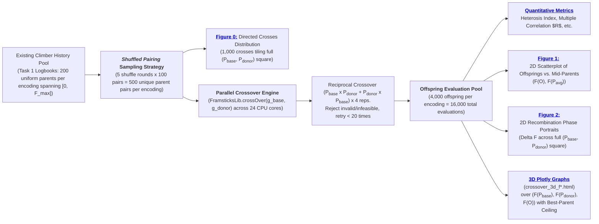
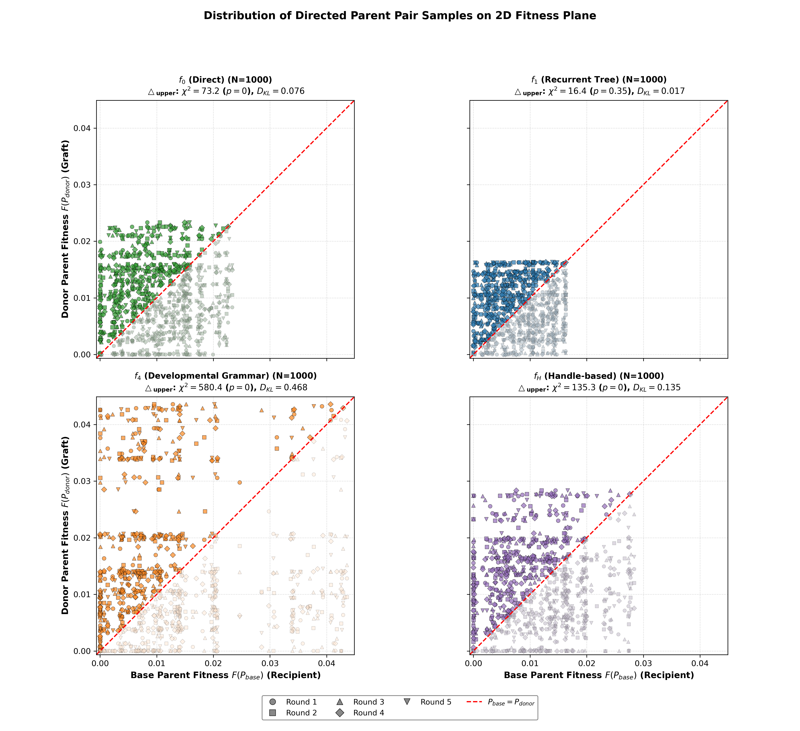
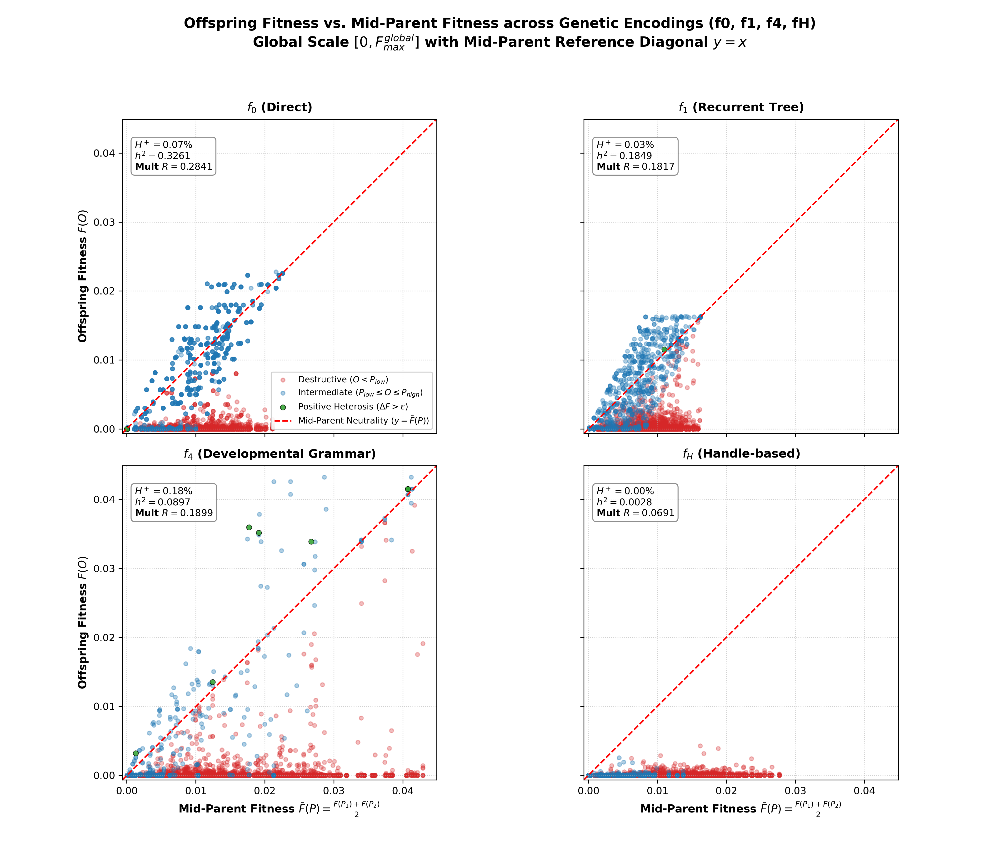
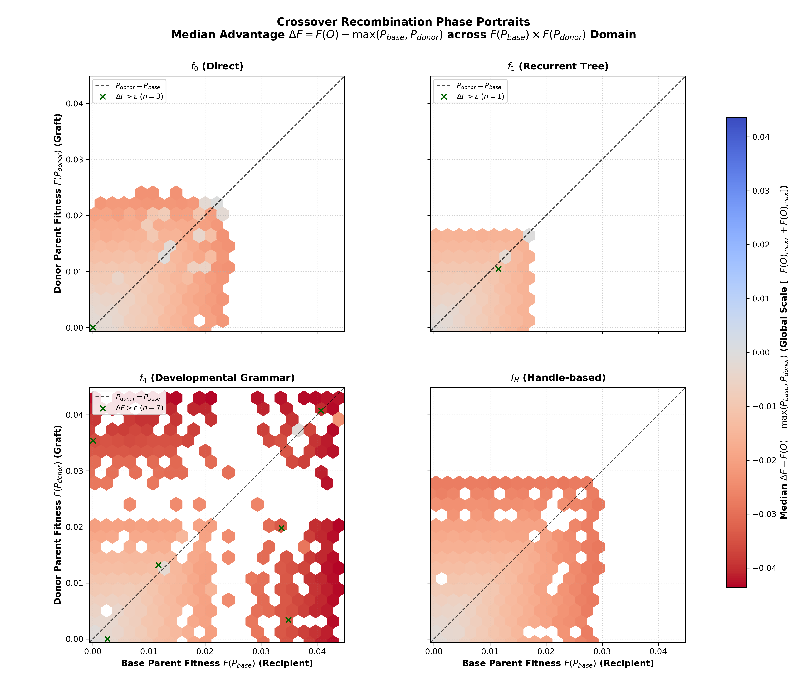
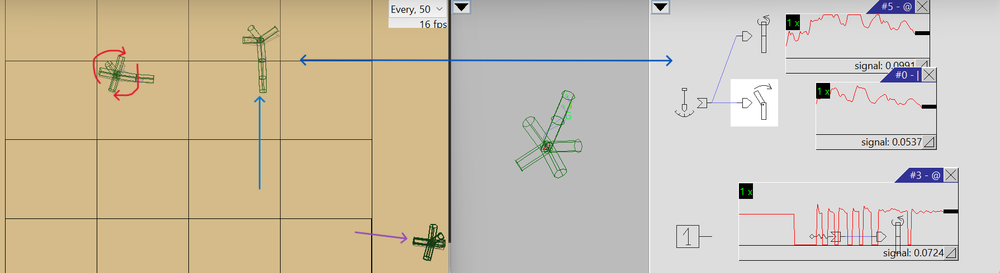

# Assignment 6: Fitness Landscape Exploration
## Task 2: Fitness Landscape Exploration under Crossover Recombination
### Investigating Recombinant Topology, Heritability, and Epistatic Disruption across Genetic Encodings

### Objective and Setup

The objective of Task 2 is to investigate the topology of the recombinant fitness landscape under sexual reproduction (**crossover**) across four distinct genetic representations ($f_0, f_1, f_4, f_H$) optimizing for net rectilinear locomotion velocity ($v = \|\mathbf{x}(T) - \mathbf{x}(0)\|T^{-1}$).

While [Task 1](../task1/README.md) probed the **local mutational landscape** (1-step neighborhood properties around single parent solutions), Task 2 probes the **non-local recombinant landscape**: pairing two genetically and phenotypically distinct parents $(P_{\text{base}}, P_{\text{donor}})$ across the fitness spectrum to determine how sexual recombination blends, preserves, or disrupts phenotypic traits.

### Experiment Design & Pipeline



#### 1. Sampling Strategy: Shuffled Parent Pairing
Rather than drawing arbitrary random pairs or using complex grid stratification, **200 equasi-uniformly distributed parent solutions** [already sampled](../task1/results/landscape) along the 1D fitness spectrum $[0, F_{\max}]$ from Task 1 are used. By executing [the script](./analyze_crossover.py) with $R = 5$ independent random permutation rounds $r$ and pairing adjacent even-odd indices $(0_r, 1_r), (2_r, 3_r), \dots, (198_r, 199_r)$, one obtains:
- $100 \text{ pairs/round} \times 5 \text{ rounds} = \mathbf{500} \text{ unique parent pairs per representation}$.
- Quasi-uniform marginal 1D distributions ([Task 1](..//task1/README.md#fig-distribution-parents-climbers)) guarantee a quasi-uniform 2D joint density across the Cartesian square $[0, F_{\max}] \times [0, F_{\max}]$ when both reciprocal directions are evaluated.

#### 2. Framsticks Crossover Mechanics & Reciprocal Directionality
In the Framsticks simulation framework, sexual recombination [`FramsticksLib.crossOver(g_base, g_donor)`](https://www.framsticks.com/files/classdoc/c_genman.html) operates as a **directional, single-offspring operator**:
- The first parent genotype `g_base` serves as the primary structural backbone into which new genetic material is integrated.
- The second parent genotype `g_donor` serves as the source from which an excised substructure, branch, or rule is grafted into the recipient chassis.

**Representation-Specific Mechanics**

|Encoding|Mechanism|
|---|---|
|**Direct Encoding ($f_0$)**|Single-point or multi-point **string swaps** between the parents - exchanges random subsets of parts and connections then attempts automated repair pass to reconnect dangling joints.|
|**Recurrent Tree ($f_1$)**|True **tree-swapping operator** - chooses a cut node in the base parent genotype ($g_{\text{base}}$) and a donor node in the second parent genotype ($g_{\text{donor}}$), preserving branch-level modularity.|
|**Developmental Grammar ([$f_4$](https://www.framsticks.com/a/al_geno_f4.html#operators))**|**Swaps production rules or symbol substrings** between generative developmental programs, altering subsequent cellular unfolding.|
|**Handle-based Encoding ($f_H$)**|**Swaps coordinate handles** in Euclidean space, disrupting the distance-dependent receptor bonding that forms morphological joints and neural circuits.|

Because swapping parent arguments (`crossOver(g1, g2)` vs. `crossOver(g2, g1)`) yields distinct offspring structures, evaluating both reciprocal crosses ($P_{\text{low}} \times P_{\text{high}}$ and $P_{\text{high}} \times P_{\text{low}}$) produces $2 \times 500 = \mathbf{1,000} \text{ directed crosses}$ per representation. Each directed cross is evaluated with $K = 4$ independent stochastic repetitions resulting in $\mathbf{4,000} \text{ offspring per representation} \rightarrow \mathbf{16,000} \text{ total evaluations}.$

<!-- PROBABLY WILL BE REMOVED (redundant):
      The resulting sample of $4,000$ quadruples $(P_{\text{base}}, P_{\text{donor}}, \bar{P}, O)$ tiles the complete Cartesian square $[0, F_{\max}] \times [0, F_{\max}]$, where the diagonal $P_{\text{base}} = P_{\text{donor}}$ serves as the symmetry reference axis.
-->

#### 3. Infeasibility Rejection & Lethality Tracking
Offspring producing syntactically invalid genotypes (`GENOTYPE_INVALID`) or failing physical simulation (`velocity == FITNESS_VALUE_INFEASIBLE_SOLUTION = -999999.0`) are immediately rejected and re-attempted (up to 20 retries, same as mutations are reattempted in [Task 1](..//task1/README.md#fitness-landscape-probing-results)), failed attempts are then used to calculate the **Crossover Lethality Rate**.

#### 4. Rationale for Excluding Outlier Isolation
Unlike the local point-mutation analysis in [Task 1](..//task1/README.md#isolating-the-influence-of-outliers), identifying and isolating evolutionary "lottery" outlier lineages is deliberately omitted here. 

When pairing parents across independently evolved runs, discarding pairs containing even one outlier parent introduces severe combinatorial entanglement and discards over 45% of sampled pairs, depriving the analysis of critical data in the high-fitness regime. Furthermore, empirical results in the Task 1 confirm that crossover mechanics do not severely skew overall metrics. Moreover, in both cases, the epistatic disruption of locomotion circuits and mechanics impairment follow identical physical laws. Retaining the complete, unpruned sample of 500 pairs per encoding guarantees uniform coverage across the entire parent fitness plane without arbitrary data loss, and avoids unnecessarily complicated analysis.

<a id="fig-parents-distribution"></a>

<p align="center">
  
  <br>

_**Figure 0:** Empirical distribution of the 1,000 directed crosses (500 parent pairs evaluated in both reciprocal directions) on the 2D joint fitness plane $(F(P_{\text{base}}), F(P_{\text{donor}}))$ within a square $[0, F_{\max}^{\text{global}}]^2$ with the $P_{\text{base}} = P_{\text{donor}}$ reference diagonal. The samples are uniformly distributed for $f_1$ ($p = 0.355, D_{\text{KL}} = 0.017$) and heavily skewed in $f_4$ ($p \approx 0, D_{\text{KL}} \approx 0.468$)._
</p>

### Quantitative Crossover Metrics

To mathematically characterize the recombinant fitness landscape and determine single-number descriptors of crossover behavior in each representation, similar to  [Task 1](../task1/README.md#quantitative-landscape-metrics) , but in contrast to it, with special focus on the effect of the two-parent combinations:

#### 1. Primary Metric: Positive Heterosis Index ($H^+$)
Following the analogous analysis in Task 1, this metric captures the empirical probability that crossover leads to offspring that **strictly outperform both parents** ($\epsilon = 10^{-6}$):

$$\mathbf{H^+}(S_{\text{cross}}^{\text{enc}}) = \frac{1}{|S_{\text{cross}}^{\text{enc}}|} \sum_{(P_{\text{base}}, P_{\text{donor}}, O) \in S_{\text{cross}}^{\text{enc}}} \mathbb{I}\big[ \underbrace{F(O) - \max\left(F(P_{\text{base}}), F(P_{\text{donor}})\right)}_{\mathrel{=:}\text{ Fitness Gain\ \ } \Delta F} > \epsilon\big]$$

- **$H^+ \approx 0\%$** implies crossover is purely destructive or neutral; sexual recombination offers no building-block advantage over asexual mutation.
- **$H^+ > 0\%$**, i.e. _fitness gain_ is often positive, implies crossover is beneficial and confirms genuine recombinant synergy (transgressive segregation / positive heterosis).

#### 2. Multiple Correlation ($R$) & Weights $(\beta_{\text{base}}, \beta_{\text{donor}})$ 
Following analogy of the role of Pearson correlation coefficient in the [Task 1](../task1/README.md#quantitative-landscape-metrics) results analysis, the multiple correlation coefficient is used as a descriptor of the linear relationship between the offspring fitness and the parental fitness, this time with two independent variables:

$$F(O) \sim \beta_0 + \beta_{\text{base}} F(P_{\text{base}}) + \beta_{\text{donor}} F(P_{\text{donor}})$$

The overall linear predictability is quantified by the **Coefficient of Multiple Correlation** ($R$):

$$R = \sqrt{R^2} = \sqrt{1 - \frac{SS_{\text{res}}}{SS_{\text{tot}}}}$$

where $SS_{\text{res}} = \sum_{i=1}^M \left(F(O_i) - \hat{F}(O_i)\right)^2$ is the residual sum of squares and $SS_{\text{tot}} = \sum_{i=1}^M \left(F(O_i) - \bar{F}(O)\right)^2$ is the total sum of squares of offspring fitness. The relative ratio of these two values measures the proportion of unexplained variance around the bi-parental regression plane.

**Physical Meaning of Regression Weights $(\beta_{\text{base}}, \beta_{\text{donor}})$**:
- $\beta_{\text{base}}$ measures the heritable trait retention from the recipient chassis.
- $\beta_{\text{donor}}$ measures the heritable trait transmission from the grafted donor component.

The following table demonstrates that these roles are rather irrelevant even in the case of $f_4$.

**Additionally**, Pearson correlation between fitness gain $\Delta F$ and average parent fitness $\bar{F}(P)$ was calculated to explain linear gradient of the phased fitness landscape on [Figure 2](#fig-crossover-phase-portrait). Relatively high values in $f_1$, $f_4$ and $f_H$ with low weights suggest that offspring fitness value likely connects to a zero constant (concentration along $F(P_{low}) \times F(P_{high} ) \times 0$ plane) rather than parental fitness values.

### Results

The table below summarizes all 16,000 evaluations across all four encodings evaluated on the full, unpruned sample of 500 parent pairs (4,000 offspring per encoding):

<a id="table-crossover-summary"></a>

| Representation | Heterosis $H^+$ ($\Delta F > \epsilon$) | Intermediate ($P_{\text{low}} \le O \le P_{\text{high}}$) | Destructive ($O < P_{\text{low}}$) | Multiple $R$ | Weights $(\beta_{\text{base}}, \beta_{\text{donor}})$ | Pearson $r(\Delta F, \bar{F}(P))$ | Lethality Rate | Max Parent | Max Offspring |
| :--- | :---: | :---: | :---: | :---: | :---: | :---: | :---: | :---: | :---: |
| **$f_0$ (Direct)** | 3 (0.07%) | **<span style="color: darkblue; font-weight: bold;">1,059 (26.47%)</span>** | 2,938 (73.45%) | **<span style="color: #640027; font-weight: bold;">0.2841</span>** | (**<span style="color: darkblue; font-weight: bold;">0.158</span>**, **<span style="color: darkblue; font-weight: bold;">0.168</span>**) | **<span style="color: #470044; font-weight: bold;">-0.4884</span>** | **<span style="color: darkblue; font-weight: bold;">0.02%</span>** | 0.023337 | 0.022788 |
| **$f_1$ (Recurrent Tree)** | 1 (0.03%) | 765 (19.12%) | 3,234 (80.85%) | <span style="color: #720019;">0.1817</span> | (0.092, 0.093) | <span style="color: #390052;">-0.5897</span> | 6.72% | **<span style="color: darkred; font-weight: bold;">0.016334</span>** | 0.016334 |
| **$f_4$ (Grammar)** | **<span style="color: darkgreen; font-weight: bold;">7 (0.18%)</span>** | 324 (8.10%) | **<span style="color: darkred; font-weight: bold;">3,669 (91.72%)</span>** | <span style="color: #71001a;">0.1899</span> | (0.047, 0.043) | <span style="color: #140077;">-0.8546</span> | 3.66% | **<span style="color: darkblue; font-weight: bold;">0.043587</span>** | **<span style="color: darkblue; font-weight: bold;">0.043232</span>** |
| **$f_H$ (Handle-based)** | 0 (0.00%) | 363 (9.07%) | 3,637 (90.92%) | **<span style="color: #81000a; font-weight: bold;">0.0691</span>** | (0.002, 0.001) | **<span style="color: #0e007d; font-weight: bold;">-0.9008</span>** | **<span style="color: darkred; font-weight: bold;">20.74%</span>** | 0.028365 | **<span style="color: darkred; font-weight: bold;">0.004268</span>** |

### Landscape Visualizations

<a id="fig-crossover-scatter"></a>

<p align="center">
  
  <br>

_**Figure 1:** Offspring fitness $F(O)$ plotted against mid-parent fitness $\bar{F}(P) = \frac{F(P_1) + F(P_2)}{2}$ within a square $[0, F_{\max}^{\text{global}}]^2$ with the mid-parent neutrality diagonal $y = x$. Points are categorized into Destructive (red), Intermediate blending (blue), and Positive Heterosis (green). Each subplot demonstrates a projection plane of the [3D parent-offspring fitness space](#fig-crossover-3d)._

<a id="fig-crossover-phase-portrait"></a>

<p align="center">
  
  <br>
</p>

_**Figure 2:** 2D Recombination Phase Portraits showing median fitness advantage over the higher-fitness parent $\Delta F$. The diagonal $P_{\text{donor}} = P_{\text{base}}$ serves as the symmetry reference. Neutral grey/white hexagons indicate near-neutral recombination ($\Delta F \approx 0$), while bright red hexagons indicate severe disruption. Green crosses mark rare recombinant solutions strictly outperforming both parents_ ($\Delta F > \epsilon$).

<a id="3d-plots"></a>

### Interactive 3D Visualizations (Plotly)

Each ([$f_0$](./results/crossover/crossover_3d_f0.html), [$f_1$](./results/crossover/crossover_3d_f1.html), [$f_4$](./results/crossover/crossover_3d_f4.html), [$f_H$](./results/crossover/crossover_3d_fH.html)) 3D model plots $(X=F(P_{\text{base}}), Y=F(P_{\text{donor}}), Z=F(O))$ with markers colored by $\Delta F$ on a globally shared symmetric diverging color scale against 3D reference surfaces:
- **Best-Parent Ceiling ($Z = \max(X, Y)$)** is composed of two distinct semiplanes.
- **Mid-Parent Neutrality Plane ($Z = \frac{X + Y}{2}$)** - soft blue reference plane representing perfectly additive, intermediate trait transmission.
- **Mid-Parent Projection Plane ($X = Y$)** - subtle vertical plane representing the exact 2D projection screen captured by [Figure 1](#fig-crossover-scatter), with the dashed neutrality line ($y = x$).
- **Offsprings exceeding the higher-fitness parent** are rendered as distinct green circle markers ($O > \max(P_{\text{base}}, P_{\text{donor}})$).

### Summary of empirical observations

Visual examination of the 3D plots, [Figure 1](#fig-crossover-scatter), [2](#fig-crossover-phase-portrait) and [correlation between $\Delta F$ and mid-parent fitness $\bar{F}(P)$](#table-crossover-summary) reveals that the major distribution of the phase portraits is shaped by near-zero-fitness offsprings, that is **crossover is predominantly destructive**.

In the case of [$f_4$](./results/crossover/crossover_3d_f4.html) and [$f_H$](./results/crossover/crossover_3d_fH.html) most points (Pearson $r<-0.85$) lie near the plane $F(P_{low}) \times F(P_{high} ) \times 0$ (i.e. crossover maps pairs of parents to 0 fitness), while  [$f_0$](./results/crossover/crossover_3d_f0.html) and [$f_1$](./results/crossover/crossover_3d_f1.html), however, demonstrate that some part of their populations actually lie somewhere in between that plane and best-parent ceiling, with **19 to 26% of all offsprings having fitness between parental values**. Hence, there is no fitness level where crossover is systematically beneficial, positive heterosis is virtually absent ($\le 0.18\%$). The meaningful difference lies entirely in **representation**.

### Key Conclusions

1) **Crossover is overwhelmingly destructive in [Locomotion](#objective-and-setup)** across all four genetic encodings (destructive rate $\ge 73\%$). In physics-grounded evolutionary robotics, fitness is an intensely non-linear, epistatic phenomenon: an organism cannot run with "half a leap and half a crawl" (see [Figure 3](#fig-example-offspring)).
2) The classical Genetic Algorithm assumption that crossover innovates by assembling independent building blocks is challenged by severe epistatic coupling. Positive heterosis ($H^+ > 0$) remains exceptionally rare (across all representations it is $\le 0.18\%=H^+(f_4)$). Hence **building block hypothesis requires elaborated implementation constraints**.
3) **Inversion of Mutational vs. Recombinant Robustness in** $f_H$:
   A critical finding is the complete inversion of performance for the handle-based encoding $f_H$:
   - Under **asexual point mutation** ([Task 1](..//task1/README.md#table-neighborhood-characteristics)), $f_H$ was the superior, most robust representation ($58.3\%$ neutrality, lowest disruption rate).
   - Under **sexual crossover** ([Task 2](#table-crossover-summary)), $f_H$ suffered **extreme destructiveness (90.92%) & lethality (20.74%)**. The peak parent fitness of $0.028365$ collapsed to a maximum offspring fitness of only $0.004268$ (zero positive heterosis, $H^+ = 0.00\%$).
   This demonstrates that geometric handle clustering creates smooth local neutral networks for point mutation, but exhibits extreme non-locality and vulnerability under macro-recombination.
   - $f_H$ appears to be **completely unsuited for sexual crossover**: total heritability failure ($R = 0.0691$) and negligible parent trait transmission $(\beta_{\text{base}} = 0.002, \beta_{\text{donor}} = 0.001)$ confirm that.

   <a id="fig-example-offspring"></a>

   <p align="center">
     
     <br>
   </p>

   <div style="margin-left: 25px; padding-left: 10px;">

   _**Figure 3:** Visual inspection of an [offspring](./experiments/O2.gen) of two randomly picked parents ([base crawler](./experiments/P1.gen) and [donor-jumper](./experiments/P2.gen)) with fitness $>0.01$, with 80% destructiveness, selected by the [`inspect_crossover.py`](./inspect_crossover.py) script from [the existing pool](../task1/results/landscape/landscape_data_fH.csv). Arrows on the left panel indicate net displacement, red arrows on the left schematically represent chaotic oscillations around initial position of the offspring, which correspond to the uncoordinated movements performed by the main circuit inherited from the base parent (horizontal line) and opposed by chaotic contractions of it's rotation muscle (inherited from the donor parent) and then connected to a sensor, as depicted on the right panel. Blending two bodies of parents (see central panel) along with their central movement circuits and induced patterns heavely disables their offspring from performing a meaningful movement (the leftmost creature), yielding devastating decrease in fitness and almost zero net displacement._

   </div>

4) **Optimal Evolutionary Regimes**:
   - For pure sexual reproduction, **direct encoding ($f_0$)** provides the most reliable additive trait inheritance ($R = 0.2841$) and the lowest lethality (0.02%), while **developmental grammar ($f_4$)** offers the highest probability of innovation ($H^+ = 0.18\%$) (at the cost of high distruction rate $91.7\%$).
   - For high-fitness parents, crossover should be heavily restricted or paired with adaptive mating strategies (e.g., speciation, niching, or homomorphic crossover) to avoid the devastating penalty of outbreeding depression.


### How to run

```bash
python "assignments/Assignment 6 - Fitness Landscape Exploration/task2/analyze_crossover.py" `
    --formats 0 1 4 H `
    --frams-path Framsticks55 `
    --task1-dir "assignments/Assignment 6 - Fitness Landscape Exploration/task1/results/landscape" `
    --out-dir "assignments/Assignment 6 - Fitness Landscape Exploration/task2/results/crossover" `
    --workers 24
```
