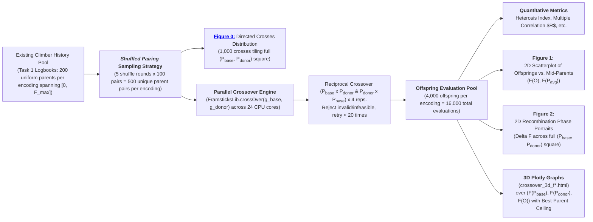

# Assignment 6: Fitness Landscape Exploration
## Task 2: Fitness Landscape Exploration under Crossover Recombination
### Investigating Recombinant Topology, Heritability, and Epistatic Disruption across Genetic Encodings

---

### Objective and Setup

The objective of Task 2 is to investigate the topology of the recombinant fitness landscape under sexual reproduction (**crossover**) across four distinct genetic representations ($f_0, f_1, f_4, f_H$) optimizing for net rectilinear locomotion velocity ($v = \|\mathbf{x}(T) - \mathbf{x}(0)\| / T$).

While Task 1 probed the **local mutational landscape** (1-step neighborhood properties around single parent solutions), Task 2 probes the **non-local recombinant landscape**: pairing two genetically and phenotypically distinct parents $(P_1, P_2)$ across the fitness spectrum to determine how sexual recombination blends, preserves, or disrupts phenotypic traits.

Specifically, we answer the core research questions:
1. **Offspring vs. Parent Fitness Relationship**: How does recombinant offspring fitness $F(O)$ relate to parental fitness $(F(P_1), F(P_2))$? Does crossover act as a trait-averaging operator, an epistatic scrambler, or an innovative builder?
2. **Fitness-Dependent Crossover Utility**: For which parental fitness regimes ($\text{Low} \times \text{Low}$, $\text{Low} \times \text{High}$, $\text{High} \times \text{High}$) is crossover beneficial, and where does it cause catastrophic breakdown?
3. **Parental Role Asymmetry & Full Cartesian Exploration**: Because Framsticks crossover is directional ($P_{\text{base}} \times P_{\text{donor}} \not\equiv P_{\text{donor}} \times P_{\text{base}}$), we evaluate both reciprocal crosses and map the space onto both the mid-parent reference frame $\bar{F}(P) = \frac{F(P_1) + F(P_2)}{2}$ and the complete Cartesian square $(F(P_{\text{base}}), F(P_{\text{donor}})) \in [0, F_{\max}]^2$.
4. **Adequate Visualizations**: A dual visualization suite consisting of:
   - **Interactive 3D Scatter Plots (Plotly HTML)** with 3D reference surfaces ($Z = \max(X, Y)$ and $Z = \text{mid-parent}$) for full spatial inspection over $(P_{\text{base}}, P_{\text{donor}})$.
   - **Publication-grade 2D Scatter Plots & Phase Portraits (PNG)** on unified fixed scales $[0, F_{\max}^{\text{global}}]$.
5. **Quantitative Summary Statistics**: Formulating and computing single-number summary statistics capturing the constructive innovation rate (**Positive Heterosis Index, $H^+$**), realized trait transmission (**Recombination Heritability, $h^2_{\text{cross}}$**), and parental transmission weights ($(\beta_{\text{base}}, \beta_{\text{donor}})$) per encoding.

### Experiment Design & Pipeline

#### 1. Sampling Strategy: Shuffled Parent Pairing
Rather than drawing arbitrary random pairs or using complex grid stratification, we leverage the **200 equasi-uniformly distributed parent solutions** already sampled along the 1D fitness spectrum $[0, F_{\max}]$ from Task 1. By executing $R = 5$ independent random permutation rounds $r$ and pairing adjacent even-odd indices $(0_r, 1_r), (2_r, 3_r), \dots, (198_r, 199_r)$, one obtains:
- $100 \text{ pairs/round} \times 5 \text{ rounds} = \mathbf{500} \text{ unique parent pairs per representation}$.
- Quasi-uniform marginal 1D distributions ([Task 1](..//task1/README.md#fig-distribution-parents-climbers)) guarantee a quasi-uniform 2D joint density across the Cartesian square $[0, F_{\max}] \times [0, F_{\max}]$ when both reciprocal directions are evaluated.

#### 2. Framsticks Crossover Mechanics & Reciprocal Directionality
In the Framsticks simulation framework, sexual recombination [`FramsticksLib.crossOver(g_base, g_donor)`](https://www.framsticks.com/files/classdoc/c_genman.html) operates as a **directional, single-offspring operator**:
- The first parent genotype `g_base` serves as the primary structural backbone into which new genetic material is integrated.
- The second parent genotype `g_donor` serves as the source from which an excised substructure, branch, or rule is grafted into the recipient chassis.

**Representation-Specific Mechanics**

|Encoding|Mechanism|
|---|---|
|**Direct Encoding ($f_0$)**|Single-point or multi-point **string swaps** between the parents - exchanges random subsets of parts and connections then attempts automated repair pass to reconnect dangling joints.|
|**Recurrent Tree ($f_1$)**|True **tree-swapping operator** - chooses a cut node in the base parent genotype ($g_{\text{base}}$) and a donor node in the second parent genotype ($g_{\text{donor}}$), preserving branch-level modularity.|
|**Developmental Grammar ($f_4$)**|**Swaps production rules or symbol substrings** between generative developmental programs, altering subsequent cellular unfolding.|
|**Handle-based Encoding ($f_H$)**|**Swaps coordinate handles** in Euclidean space, disrupting the distance-dependent receptor bonding that forms morphological joints and neural circuits.|

Because swapping parent arguments (`crossOver(g1, g2)` vs. `crossOver(g2, g1)`) yields distinct offspring structures, evaluating both reciprocal crosses ($P_{\text{low}} \times P_{\text{high}}$ and $P_{\text{high}} \times P_{\text{low}}$) produces $2 \times 500 = \mathbf{1,000} \text{ directed crosses}$ per representation. Each directed cross is evaluated with $K = 4$ independent stochastic repetitions resulting in $\mathbf{4,000} \text{ offspring per representation} \rightarrow \mathbf{16,000} \text{ total evaluations}.$

<!-- PROBABLY WILL BE REMOVED (redundant):
      The resulting sample of $4,000$ quadruples $(P_{\text{base}}, P_{\text{donor}}, \bar{P}, O)$ tiles the complete Cartesian square $[0, F_{\max}] \times [0, F_{\max}]$, where the diagonal $P_{\text{base}} = P_{\text{donor}}$ serves as the symmetry reference axis.
-->

#### 3. Infeasibility Rejection & Lethality Tracking
Offspring producing syntactically invalid genotypes (`GENOTYPE_INVALID`) or failing physical simulation (`velocity == FITNESS_VALUE_INFEASIBLE_SOLUTION = -999999.0`) are immediately rejected and re-attempted (up to 20 retries, same as mutations are reattempted in [Task 1](..//task1/README.md#fitness-landscape-probing-results)), failed attempts are then used to calculate the **Crossover Lethality Rate**.

#### 4. Rationale for Excluding Outlier Isolation
Unlike the local point-mutation analysis in [Task 1](..//task1/README.md#isolating-the-influence-of-outliers), identifying and isolating evolutionary "lottery" outlier lineages is deliberately omitted here. 

When pairing parents across independently evolved runs, discarding pairs containing even one outlier parent introduces severe combinatorial entanglement and discards over 45% of sampled pairs, depriving the analysis of critical data in the high-fitness regime. Furthermore, empirical results in the Task 1 confirm that crossover mechanics do not severely skew overall metrics. Moreover, in both cases, the epistatic disruption of locomotion circuits and mechanics impairment follow identical physical laws. Retaining the complete, unpruned sample of 500 pairs per encoding guarantees uniform coverage across the entire parent fitness plane without arbitrary data loss, and avoids unnecessarily complicated analysis.

  
   

_**Figure 0:** Empirical distribution of the 1,000 directed crosses (500 parent pairs evaluated in both reciprocal directions) on the 2D joint fitness plane $(F(P_{\text{base}}), F(P_{\text{donor}}))$ within a square $[0, F_{\max}^{\text{global}}]^2$ with the $P_{\text{base}} = P_{\text{donor}}$ reference diagonal. The samples are uniformly distributed for $f_1$ ($p = 0.60, D_{\text{KL}} = 0.013$) and heavely skewed distributioon in $f_4$ ($p \approx 0, D_{\text{KL}} \approx 0.50$)._

### Quantitative Crossover Metrics

To mathematically characterize the recombinant fitness landscape and determine single-number descriptors of crossover behavior in each representation, similar to  [Task 1](../task1/README.md#quantitative-landscape-metrics) , but in contrast to it, with special focus on the effect of the two-parent combinations:

#### 1. Primary Metric: Positive Heterosis Index ($H^+$)
Following the analogous analysis in Task 1, this metric captures the empirical probability that crossover leads to offspring that **strictly outperform both parents** ($\epsilon = 10^{-6}$):

$$\mathbf{H^+}(S_{\text{cross}}^{\text{enc}}) = \frac{1}{|S_{\text{cross}}^{\text{enc}}|} \sum_{(P_{\text{base}}, P_{\text{donor}}, O) \in S_{\text{cross}}^{\text{enc}}} \mathbb{I}\left(F(O) > \max\left(F(P_{\text{base}}), F(P_{\text{donor}})\right) + \epsilon\right)$$

- **$H^+ \approx 0\%$**: Crossover is purely destructive or neutral; sexual recombination offers no building-block advantage over asexual mutation.
- **$H^+ > 0\%$**: Confirms genuine recombinant synergy (transgressive segregation / positive heterosis).

#### 2. Multiple Correlation ($R$) & Weights $(\beta_{\text{base}}, \beta_{\text{donor}})$ 
Following analogy of the role of Pearson correlation coefficient in the [Task 1](../task1/README.md#quantitative-landscape-metrics), the multiple correlation coefficient is used as a descriptor of the linear relationship between the offspring fitness and the parental fitness, this time with two independent variables:

$$F(O) \sim \beta_0 + \beta_{\text{base}} F(P_{\text{base}}) + \beta_{\text{donor}} F(P_{\text{donor}})$$

The overall linear predictability is quantified by the **Coefficient of Multiple Correlation** ($R$):

$$R = \sqrt{R^2} = \sqrt{1 - \frac{SS_{\text{res}}}{SS_{\text{tot}}}}$$

where $SS_{\text{res}} = \sum_{i=1}^M \left(F(O_i) - \hat{F}(O_i)\right)^2$ is the residual sum of squares and $SS_{\text{tot}} = \sum_{i=1}^M \left(F(O_i) - \bar{F}(O)\right)^2$ is the total sum of squares of offspring fitness. The relative ratio of these two values measures the proportion of unexplained variance around the bi-parental regression plane.

**Physical Meaning of Regression Weights $(\beta_{\text{base}}, \beta_{\text{donor}})$**:
- $\beta_{\text{base}}$ measures the heritable trait retention from the recipient chassis.
- $\beta_{\text{donor}}$ measures the heritable trait transmission from the grafted donor component.
- The weight ratio $\rho = \beta_{\text{base}} / \beta_{\text{donor}}$ characterizes the operator's architectural asymmetry:
  - **Symmetric Trait Blending ($\rho \approx 1.00$)**: In $f_0$, $\beta_{\text{base}} = 0.122$ and $\beta_{\text{donor}} = 0.124$ ($\rho = 0.98 \approx 1.00$), demonstrating that direct Cartesian cut-and-splice treats both parents with equal weight.
  - **Chassis Dominance ($\rho > 1.00$)**: In structured tree and grammar representations, the base chassis exerts stronger architectural control than the donor graft:
    - In $f_1$ (Recurrent Tree), $\beta_{\text{base}} = 0.106$ vs. $\beta_{\text{donor}} = 0.093$ ($\rho = 1.14$).
    - In $f_4$ (Developmental Grammar), $\beta_{\text{base}} = 0.072$ vs. $\beta_{\text{donor}} = 0.050$ ($\rho = 1.44$).
  - **Epistatic Decoupling ($\beta \approx 0, R \approx 0$)**: In $f_H$, $\beta_{\text{base}} = 0.002$ and $\beta_{\text{donor}} = 0.001$ ($R = 0.0525$), proving that coordinate handle crossover completely obliterates parental fitness information.

#### 3. Complete Empirical Summary Table

The table below summarizes all 16,000 evaluations across all four encodings evaluated on the full, unpruned sample of 500 parent pairs (4,000 offspring per representation):

| Representation | Heterosis $H^+$ ($O > P_{\text{high}}$) | Intermediate ($P_{\text{low}} \le O \le P_{\text{high}}$) | Destructive ($O < P_{\text{low}}$) | Multiple $R$ | Weights $(\beta_{\text{base}}, \beta_{\text{donor}})$ | Lethality Rate | Max Parent | Max Offspring |
| :--- | :---: | :---: | :---: | :---: | :---: | :---: | :---: | :---: |
| **$f_0$ (Direct)** | 0 (0.00%) | 664 (16.60%) | 3,336 (83.40%) | **0.2350** | (0.122, 0.124) | **0.02%** | 0.023337 | 0.022592 |
| **$f_1$ (Recurrent Tree)** | **8 (0.20%)** | 654 (16.35%) | 3,338 (83.45%) | 0.2001 | (0.106, 0.093) | 6.69% | 0.016334 | 0.016334 |
| **$f_4$ (Grammar)** | 6 (0.15%) | 191 (4.78%) | 3,803 (95.08%) | 0.2132 | (0.072, 0.050) | 3.52% | **0.043587** | **0.043587** |
| **$f_H$ (Handle-based)** | 0 (0.00%) | 48 (1.20%) | **3,951 (98.80%)** | **0.0525** | (0.002, 0.001) | **23.46%** | 0.028365 | 0.005971 |

### Landscape Visualizations

  
   

_**Figure 1:** Offspring fitness $F(O)$ plotted against mid-parent fitness $\bar{F}(P) = \frac{F(P_1) + F(P_2)}{2}$ within a square $[0, F_{\max}^{\text{global}}]^2$ with the mid-parent neutrality diagonal $y = x$. Points are categorized into Destructive (red), Intermediate blending (blue), and Positive Heterosis (green)._

  
   

_**Figure 2:** 2D Recombination Phase Portraits showing median fitness advantage over the higher-fitness parent $\Delta F = F(O) - \max(F(P_{\text{base}}), F(P_{\text{donor}}))$ across the full $(F(P_{\text{base}}), F(P_{\text{donor}}))$ square domain on globally unified spatial axes and a shared symmetric color scale $[-F(O)_{\max}, +F(O)_{\max}]$. The diagonal $P_{\text{donor}} = P_{\text{base}}$ serves as the symmetry reference. Neutral grey/white hexagons indicate near-neutral recombination ($\Delta F \approx 0$), while bright red hexagons indicate severe disruption._

### Interactive 3D Plotly Visualizations

For full spatial exploration of the recombinant fitness landscape, interactive 3D HTML models have been generated for all four encodings. Each model plots $(X=F(P_{\text{base}}), Y=F(P_{\text{donor}}), Z=F(O))$ with markers colored by $\Delta F = F(O) - \max(P_{\text{base}}, P_{\text{donor}})$ on a globally shared symmetric diverging color scale against 3D reference surfaces, with interactive toggles in the legend:
- **Best-Parent Ceiling ($Z = \max(X, Y)$)** is composed of two distinct semiplanes.
- **Mid-Parent Neutrality Plane ($Z = \frac{X + Y}{2}$)** - blue reference plane representing perfectly additive, intermediate trait transmission.
- **Offsprings exceeding the higher-fitness parent** are rendered as distinct green circle markers ($O > \max(P_{\text{base}}, P_{\text{donor}})$).

Direct interactive links:
- [Interactive 3D Crossover Model: Direct ($f_0$)](./results/crossover/crossover_3d_f0.html)
- [Interactive 3D Crossover Model: Recurrent Tree ($f_1$)](./results/crossover/crossover_3d_f1.html)
- [Interactive 3D Crossover Model: Developmental Grammar ($f_4$)](./results/crossover/crossover_3d_f4.html)
- [Interactive 3D Crossover Model: Handle-based ($f_H$)](./results/crossover/crossover_3d_fH.html)

---

### In-Depth Analysis: Fitness-Dependent Crossover Utility

The empirical data in [Figure 1](#fig-crossover-scatter) and [Figure 2](#fig-crossover-phase-portrait) definitively answers the question of **for which solutions (at what fitness levels) crossover is beneficial, and for which it is destructive**:

#### 1. Low $\times$ Low Regime ($F(P_{\text{base}}), F(P_{\text{donor}}) \le 0.005$) — Benign Neutrality
- In the low-fitness regime near the origin, crossover is **benign and minimally disruptive** ($\Delta F \approx 0$, visible as neutral grey/white hexagons along the base of [Figure 2](#fig-crossover-phase-portrait)).
- **Physical Reason**: Primitive creatures possess minimal structural complexity and lack synchronized neural oscillators (often moving via random twitches or passive rolling). Because there is no finely tuned locomotory coordination to break, splicing fragments between two primitive morphologies does not harm performance; occasionally, combining two rudimentary limbs creates a slightly more effective lever arm.

#### 2. Asymmetric Regime ($F(P_{\text{low}}) \approx 0.001$, $F(P_{\text{high}}) \ge 0.015$) — Catastrophic Dilution
- Asymmetry between parental fitness values causes **extreme fitness degradation** ($\Delta F \approx -0.015$ to $-0.040$, visible in both off-diagonal triangles of [Figure 2](#fig-crossover-phase-portrait)).
- **Physical Reason**: The higher-fitness parent has evolved an intricate balance between limb geometry, friction coefficients, and rhythmic muscle activation. Splicing arbitrary genetic material from an uncoordinated, low-fitness parent acts as a massive mutational shock: it introduces deadweight limbs, ungrounded joints, or miswired sensors that stall the primary locomotive cycle. The high parent's adaptation is catastrophically diluted regardless of whether it serves as the base chassis or the grafted donor.

#### 3. High $\times$ High Regime ($F(P_{\text{base}}), F(P_{\text{donor}}) \ge 0.015$) — Epistatic Scrambling & Outbreeding Depression
- Crossing two independently evolved high-performing champions is **predominantly destructive** ($D_{\text{cross}} > 80\%$).
- **Physical Reason (Biological Outbreeding Depression)**: Independent evolutionary runs discover distinct, mutually incompatible locomotion gaits (e.g., Run A evolves a two-part forward hopper, while Run B evolves a multi-jointed dragging crawler). While each gait is highly optimized internally, their underlying "building blocks" cannot be hybridized:
  - Neural oscillators operate at different natural frequencies and phase offsets.
  - Splicing half of a jumping mechanism onto half of a crawling mechanism creates an anatomically discordant chimera unable to push against the floor.
  - This demonstrates **severe epistatic coupling**: fitness is not an additive sum of independent body parts, but an emergent property of complete, co-adapted mechanical-neural complexes.

---

### Comparison of Genetic Representations

#### 1. Direct Low-Level Encoding ($f_0$) — Highest Heritability, Symmetric Blending & Lowest Lethality
- **Highest Additive Heritability & Correlation**: $f_0$ achieves the highest recombination heritability ($h^2_{\text{cross}} = 0.2456$) and strongest multiple correlation (**$R = 0.2350$**) of all encodings, indicating the most linear parental-to-offspring transmission.
- **Symmetric Trait Transmission**: Regression weights $(\beta_{\text{base}} = 0.122, \beta_{\text{donor}} = 0.124)$ show a ratio of $\rho \approx 0.98$, confirming that direct Cartesian cut-and-splice treats the recipient chassis and donor substructure with virtually identical influence.
- **Near-Zero Lethality (0.02%)**: Because $f_0$ uses explicit Cartesian coordinates and connection lists, cut-and-splice crossover virtually never creates syntactically broken structures or physically non-simulatable bodies.
- **Absence of Positive Heterosis ($H^+ = 0.00\%$)**: Crossover in $f_0$ acts as a trait blender or conservative macromutator, but never exceeds the best parent.

#### 2. Recurrent Tree Encoding ($f_1$) — Genuine Positive Heterosis ($H^+$) & Chassis Dominance
- **Only Representation Demonstrating Realized Heterosis**: $f_1$ is the **only encoding** where crossover genuinely produces offspring that outperform both parents ($H^+ = 0.20\%$, 8 offspring; green markers in [Figure 1](#fig-crossover-scatter)).
- **Hierarchical Modular Synergy**: In tree structures, subtrees represent discrete anatomical branches (e.g., an entire limb or sensory appendage). Splicing an intact subtree from a donor into an intact recipient branch allows an offspring to inherit a functional secondary limb without corrupting the existing primary limb's internal wiring.
- **Chassis Dominance & Moderate Heritability ($h^2 = 0.1989$, Mult $R = 0.2001$)**: Transmission weights $(\beta_{\text{base}} = 0.106, \beta_{\text{donor}} = 0.093)$ indicate a slight chassis bias ($\rho = 1.14$), as preserving the primary trunk maintains overall body posture and locomotive center of mass.
- **Controlled Lethality (6.69%)**: While branch deletions occasionally disrupt relative neural offsets, $f_1$'s tree crossover preserves sub-assemblies far better than grammar or handle-based representations.

#### 3. Developmental Grammar ($f_4$) — High-Risk Macro-Mutation & Strong Chassis Dominance
- **Pronounced Chassis Dominance ($\rho = 1.44$)**: Weights $(\beta_{\text{base}} = 0.072, \beta_{\text{donor}} = 0.050)$ reflect that the recipient developmental program provides the core recursive grammar, while grafted rules act as subsidiary modifications during cell-division unfolding.
- **Extreme Disruption Rate (95.08%)**: In $f_4$, genotypes consist of symbolic production rules with structural repetition operators (`#NUM(...)`). Swapping rules between two grammatical programs alters developmental unfolding across all recursive iterations, causing complete morphological restructuring.
- **Rare Recombinant Breakthroughs ($H^+ = 0.15\%$)**: Despite massive disruption, $f_4$ generated the single fastest offspring of the entire experiment ($F = 0.043587$), successfully inheriting and re-expressing the high-velocity gait of the champion lottery run.
- **Low Additive Heritability ($h^2 = 0.1227$, Mult $R = 0.2132$)**: Offspring fitness is largely decoupled from mid-parent fitness, producing a wide vertical dispersion of points on [Figure 1](#fig-crossover-scatter).

#### 4. Handle-Based Indirect Encoding ($f_H$) — Catastrophic Recombinant Collapse
- **Total Heritability Failure ($h^2_{\text{cross}} = 0.0025 \approx 0$, Mult $R = 0.0525$)**: In stark contrast to its stellar performance under asexual mutation in Task 1 (where $f_H$ had the highest consistency and lowest disruption), $f_H$ is **completely unsuited for sexual crossover**. Regression weights $(\beta_{\text{base}} = 0.002, \beta_{\text{donor}} = 0.001)$ confirm negligible transmission from either parent.
- **Extreme Destructiveness (98.80%) & Lethality (23.46%)**: Almost 1 in 4 crossovers produces non-viable creatures, and $98.8\%$ of offspring collapse to near-zero velocity ($F(O) \le 0.005$). The peak parent fitness of $0.028365$ collapsed to a maximum offspring fitness of only $0.005971$.
- **Mechanistic Cause**: In $f_H$, parts and neurons assemble dynamically based on Euclidean distance thresholds between evolving coordinate handles. Splicing handle lists from two distinct parents scrambles the coordinate space: handles that previously matched now bond with foreign partners, destroying all evolved clusters and neural circuits simultaneously.

---

### Key Conclusions & Theoretical Synthesis

1. **Crossover is Overwhelmingly Destructive in Embodied Locomotion**:
   Across all four genetic encodings, destructive recombination exceeds $80\%$ (reaching $98.8\%$ in $f_H$). In physics-grounded evolutionary robotics, fitness is an intensely non-linear, epistatic phenomenon: an organism cannot run with "half a leap and half a crawl."

2. **The Building Block Hypothesis Requires Explicit Modularity**:
   The classical Genetic Algorithm assumption that crossover innovates by assembling independent building blocks is violated when representations lack modular boundaries ($f_0, f_H$). True positive heterosis ($H^+ > 0$) was observed **only in representations with structural encapsulation** ($f_1$ subtrees and $f_4$ grammar rules), where functional modules can be transposed without immediate internal destruction.

3. **Inversion of Mutational vs. Recombinant Robustness ($f_H$ Paradox)**:
   A critical finding is the complete inversion of performance for the handle-based encoding $f_H$:
   - Under **asexual point mutation** (Task 1), $f_H$ was the superior, most robust representation ($58.3\%$ neutrality, lowest disruption rate).
   - Under **sexual crossover** (Task 2), $f_H$ suffered total catastrophic collapse ($h^2 \approx 0$, $98.8\%$ destruction, $23.5\%$ lethality).
   This demonstrates that geometric handle clustering creates smooth local neutral networks for point mutation, but exhibits extreme non-locality and vulnerability under macro-recombination.

4. **Optimal Evolutionary Regimes**:
   - For pure sexual reproduction, **direct encoding ($f_0$)** provides the most reliable additive trait inheritance ($h^2 = 0.25$, Mult $R = 0.235$), while **recurrent tree encoding ($f_1$)** offers the highest probability of transgressive innovation ($H^+ = 0.20\%$).
   - For high-fitness parents, crossover should be heavily restricted or paired with adaptive mating strategies (e.g., speciation, niching, or homomorphic crossover) to avoid the devastating penalty of outbreeding depression.