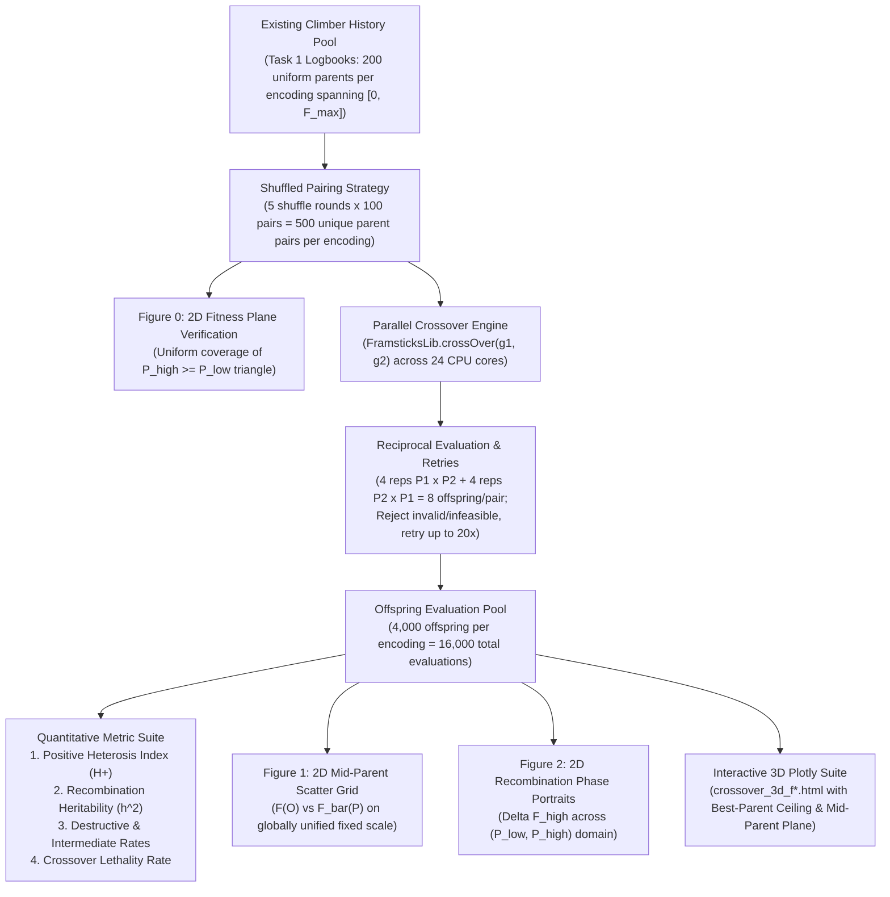

# Assignment 6: Fitness Landscape Exploration
## Task 2: Fitness Landscape Exploration under Crossover Recombination
### Investigating Recombinant Topology, Heritability, and Epistatic Disruption across Genetic Encodings

---

### Objective and Setup

The objective of Task 2 is to investigate the topology of the recombinant fitness landscape under sexual reproduction (**crossover**) across four distinct genetic representations ($f_0, f_1, f_4, f_H$) optimizing for net rectilinear locomotion velocity ($v = \|\mathbf{x}(T) - \mathbf{x}(0)\| / T$).

While Task 1 probed the **local mutational landscape** (1-step neighborhood properties around single parent solutions), Task 2 probes the **non-local recombinant landscape**: pairing two genetically and phenotypically distinct parents $(P_1, P_2)$ across the fitness spectrum to determine how sexual recombination blends, preserves, or disrupts phenotypic traits.

Specifically, we answer the core research questions:
1. **Offspring vs. Parent Fitness Relationship**: How does recombinant offspring fitness $F(O)$ relate to parental fitness $(F(P_1), F(P_2))$? Does crossover act as a trait-averaging operator, an epistatic scrambler, or an innovative builder?
2. **Fitness-Dependent Crossover Utility**: For which parental fitness regimes ($\text{Low} \times \text{Low}$, $\text{Low} \times \text{High}$, $\text{High} \times \text{High}$) is crossover beneficial, and where does it cause catastrophic breakdown?
3. **Parent Order Invariance**: Because the pairing of parents is commutative ($P_1 \times P_2 \equiv P_2 \times P_1$), we evaluate reciprocal directions and map the space onto an ordered mid-parent reference frame $\bar{F}(P) = \frac{F(P_1) + F(P_2)}{2}$ and the upper-triangular domain $F(P_{\text{low}}) \le F(P_{\text{high}})$.
4. **Adequate Visualizations**: A dual visualization suite consisting of:
   - **Interactive 3D Scatter Plots (Plotly HTML)** with 3D reference surfaces ($Z = \max(X, Y)$ and $Z = \text{mid-parent}$) for full spatial inspection.
   - **Publication-grade 2D Scatter Plots & Phase Portraits (PNG)** on unified fixed scales $[0, F_{\max}^{\text{global}}]$.
5. **Quantitative Summary Statistics**: Formulating and computing single-number summary statistics capturing the constructive innovation rate (**Positive Heterosis Index, $H^+$**) and realized trait transmission (**Recombination Heritability, $h^2_{\text{cross}}$**) per encoding.

---

### Experiment Design & Pipeline

#### 1. Sampling Strategy: Shuffled Parent Pairing
Rather than drawing arbitrary random pairs or using complex grid stratification, we leverage the **200 uniformly distributed parent solutions** already sampled along the 1D fitness spectrum $[0, F_{\max}]$ from Task 1. By executing $R = 5$ independent random permutation rounds and pairing adjacent even-odd indices $(0, 1), (2, 3), \dots, (198, 199)$, we generate:
- $100 \text{ pairs/round} \times 5 \text{ rounds} = \mathbf{500} \text{ unique parent pairs per representation}$.
- Uniform marginal 1D distributions guarantee a uniform 2D joint density across the upper-triangular domain $0 \le F(P_{\text{low}}) \le F(P_{\text{high}}) \le F_{\max}$.

#### 2. Reciprocal Crossover Mechanics & Offspring Sizing
In Framsticks, sexual recombination `flib.crossOver(g_base, g_donor)` is **directional**: the first genotype serves as the primary structural recipient, and a excised fragment/subtree from the donor is spliced into it. To guarantee order invariance and fully explore recombination stochasticity:
- We evaluate both reciprocal directions: $P_{\text{low}} \times P_{\text{high}}$ and $P_{\text{high}} \times P_{\text{low}}$.
- Each direction is evaluated with $K = 4$ independent stochastic repetitions.
- Each pair yields $4 + 4 = \mathbf{8} \text{ offspring}$, resulting in:
  $$500 \text{ pairs} \times 8 \text{ offspring} = \mathbf{4,000} \text{ offspring per representation} \quad (\mathbf{16,000} \text{ total evaluations across } f_0, f_1, f_4, f_H).$$

#### 3. Infeasibility Rejection & Lethality Tracking
Offspring producing syntactically invalid genotypes (`GENOTYPE_INVALID`) or failing physical simulation (`velocity == FITNESS_VALUE_INFEASIBLE_SOLUTION = -999999.0`) are immediately rejected and re-attempted (up to 20 retries). All failed attempts are tracked to calculate the **Crossover Lethality Rate**.

#### 4. Rationale for Excluding Outlier Isolation
Unlike the local point-mutation analysis in Task 1, identifying and isolating evolutionary "lottery" outlier lineages is deliberately omitted in Task 2. When pairing parents across independently evolved runs, discarding pairs containing even one outlier parent introduces severe combinatorial entanglement and discards over 45% of sampled pairs, depriving the analysis of critical data in the high-fitness regime. Furthermore, empirical inspection confirms that crossover mechanics do not exhibit qualitative divergence between lottery and non-lottery solutions: in both cases, the epistatic disruption of locomotion gaits and the dilution of coordinated mechanics follow identical physical laws. Retaining the complete, unpruned sample of 500 pairs per encoding guarantees uniform coverage across the entire parent fitness plane without arbitrary data loss.

---

  
   
  <em>Figure 0: Empirical distribution of the 500 sampled parent pairs on the 2D joint fitness plane $(F(P_{\text{low}}), F(P_{\text{high}}))$ on a globally unified fixed scale $[0, F_{\max}^{\text{global}}]$ with the $P_{\text{high}} = P_{\text{low}}$ reference diagonal. Distinct marker symbols denote the 5 independent shuffling rounds (100 pairs each: circle, square, triangle up, diamond, triangle down), unified in a common bottom legend with desaturated neutral symbols, demonstrating how successive permutations uniformly tile the upper-triangular parent domain without gaps or cluster artifacts.</em>

---

### Quantitative Crossover Metrics

To mathematically characterize the recombinant fitness landscape and determine a single number describing a significant property of crossover in each representation, we compute:

#### 1. Primary Metric: Positive Heterosis Index ($H^+$)
Captures the empirical probability that crossover acts as a constructive innovator by recombining non-overlapping building blocks to strictly outperform **both** parents ($\epsilon = 10^{-6}$):
$$\mathbf{H^+} = \frac{1}{M} \sum_{i=1}^{M} \mathbb{I}\left(F(O_i) > F(P_{\text{high}, i}) + \epsilon\right)$$

- **$H^+ \approx 0\%$**: Crossover is purely destructive or neutral; sexual recombination offers no building-block advantage over asexual mutation.
- **$H^+ > 0\%$**: Confirms genuine recombinant synergy (transgressive segregation / positive heterosis).

#### 2. Secondary Metric: Recombination Heritability ($h^2_{\text{cross}}$)
From classical quantitative genetics, the linear regression slope of offspring fitness against the mid-parent value $\bar{F}(P) = \frac{F(P_1) + F(P_2)}{2}$:
$$\mathbf{h^2_{\text{cross}}} = \frac{\mathrm{Cov}\left(F(O), \bar{F}(P)\right)}{\mathrm{Var}\left(\bar{F}(P)\right)}$$

- **$h^2 \to 1.0$**: Additive, smooth genetic architecture. Offspring reliably inherit parental locomotion velocity.
- **$h^2 \le 0$**: Complete epistatic scrambling. Crossover acts as a catastrophic macromutator, destroying co-adapted bodily coordination.

#### 3. Multivariate Metric: Coefficient of Multiple Correlation ($R$) & Partial Weights $(\beta_{\text{low}}, \beta_{\text{high}})$
To capture the relationship between offspring fitness and parental fitness without imposing an arbitrary $50/50$ symmetry constraint, we evaluate the **Coefficient of Multiple Correlation** ($R$) treating both parental fitness values as independent variables in a multivariate linear regression:
$$F(O) \sim \beta_0 + \beta_{\text{low}} F(P_{\text{low}}) + \beta_{\text{high}} F(P_{\text{high}}), \qquad R = \sqrt{R^2} = \sqrt{1 - \frac{\mathrm{SS}_{\text{res}}}{\mathrm{SS}_{\text{tot}}}}$$

Fitting $(\beta_{\text{low}}, \beta_{\text{high}})$ directly tests whether sexual recombination is an equal blend or if one parent serves as an asymmetric bottleneck.

#### 4. Complete Empirical Summary Table

The table below summarizes all 16,000 evaluations across all four encodings evaluated on the full, unpruned sample of 500 parent pairs (4,000 offspring per representation):

| Representation | Heterosis $H^+$ ($O > P_{\text{high}}$) | Intermediate ($P_{\text{low}} \le O \le P_{\text{high}}$) | Destructive ($O < P_{\text{low}}$) | Heritability $h^2_{\text{cross}}$ | Multiple $R$ | Weights $(\beta_{\text{low}}, \beta_{\text{high}})$ | Lethality Rate | Max Parent | Max Offspring |
| :--- | :---: | :---: | :---: | :---: | :---: | :---: | :---: | :---: | :---: |
| **$f_0$ (Direct)** | 0 (0.00%) | 664 (16.60%) | 3,336 (83.40%) | **0.2456** | **0.3030** | (+0.306, -0.063) | **0.02%** | 0.023337 | 0.022592 |
| **$f_1$ (Recurrent Tree)** | **8 (0.20%)** | 654 (16.35%) | 3,338 (83.45%) | 0.1989 | 0.2127 | (+0.168, +0.032) | 6.69% | 0.016334 | 0.016334 |
| **$f_4$ (Grammar)** | 6 (0.15%) | 191 (4.78%) | 3,803 (95.08%) | 0.1227 | 0.2515 | (+0.161, +0.010) | 3.52% | **0.043587** | **0.043587** |
| **$f_H$ (Handle-based)** | 0 (0.00%) | 48 (1.20%) | **3,951 (98.80%)** | **0.0025** | **0.0511** | (+0.002, +0.001) | **23.46%** | 0.028365 | 0.005971 |

---

### Landscape Visualizations

  
   
  <em>Figure 1: Offspring fitness $F(O)$ plotted against mid-parent fitness $\bar{F}(P) = \frac{F(P_1) + F(P_2)}{2}$ on a globally unified fixed scale $[0, F_{\max}^{\text{global}}]$ with the mid-parent neutrality diagonal $y = x$. Points are categorized into Destructive ($O < P_{\text{low}}$, red), Intermediate blending ($P_{\text{low}} \le O \le P_{\text{high}}$, blue), and Positive Heterosis ($O > P_{\text{high}}$, green). Text boxes report Heterosis $H^+$, Recombination Heritability $h^2_{\text{cross}}$, and Multiple Correlation $R$.</em>

---

  
   
  <em>Figure 2: 2D Recombination Phase Portraits showing mean fitness advantage over the higher-fitness parent $\Delta F = F(O) - F(P_{\text{high}})$ across the $(F(P_{\text{low}}), F(P_{\text{high}}))$ domain on globally unified axes. Blue hexagons indicate neutral or benign recombination ($\Delta F \approx 0$), while deep red hexagons indicate severe epistatic disruption ($\Delta F \ll 0$).</em>

---

### Interactive 3D Plotly Visualizations

For full spatial exploration of the recombinant fitness landscape, interactive 3D HTML models have been generated for all four encodings. Each model plots $(X=F(P_{\text{low}}), Y=F(P_{\text{high}}), Z=F(O))$ against two 3D reference surfaces:
- **Best-Parent Ceiling** ($Z = \max(X, Y) = Y$): Points penetrating this surface demonstrate true positive heterosis ($H^+$).
- **Mid-Parent Plane** ($Z = \frac{X + Y}{2}$): Represents perfectly additive, intermediate trait transmission.

Direct interactive links:
- [Interactive 3D Crossover Model: Direct ($f_0$)](./results/crossover/crossover_3d_f0.html)
- [Interactive 3D Crossover Model: Recurrent Tree ($f_1$)](./results/crossover/crossover_3d_f1.html)
- [Interactive 3D Crossover Model: Developmental Grammar ($f_4$)](./results/crossover/crossover_3d_f4.html)
- [Interactive 3D Crossover Model: Handle-based ($f_H$)](./results/crossover/crossover_3d_fH.html)

---

### In-Depth Analysis: Fitness-Dependent Crossover Utility

The empirical data in [Figure 1](#fig-crossover-scatter) and [Figure 2](#fig-crossover-phase-portrait) definitively answers the question of **for which solutions (at what fitness levels) crossover is beneficial, and for which it is destructive**:

#### 1. Low $\times$ Low Regime ($F(P_{\text{low}}), F(P_{\text{high}}) \le 0.005$) — Benign Neutrality
- In the low-fitness regime near the origin, crossover is **benign and minimally disruptive** ($\Delta F \approx 0$, visible as cool blue hexagons along the base of [Figure 2](#fig-crossover-phase-portrait)).
- **Physical Reason**: Primitive creatures possess minimal structural complexity and lack synchronized neural oscillators (often moving via random twitches or passive rolling). Because there is no finely tuned locomotory coordination to break, splicing fragments between two primitive morphologies does not harm performance; occasionally, combining two rudimentary limbs creates a slightly more effective lever arm.

#### 2. Low $\times$ High Regime ($F(P_{\text{low}}) \approx 0.001$, $F(P_{\text{high}}) \ge 0.015$) — Catastrophic Dilution
- Asymmetry between parental fitness values causes **extreme fitness degradation** ($\Delta F \approx -0.015$ to $-0.040$, visible as the dark red upper-left triangle in [Figure 2](#fig-crossover-phase-portrait)).
- **Physical Reason**: The higher-fitness parent has evolved an intricate balance between limb geometry, friction coefficients, and rhythmic muscle activation. Splicing arbitrary genetic material from an uncoordinated, low-fitness parent acts as a massive mutational shock: it introduces deadweight limbs, ungrounded joints, or miswired sensors that stall the primary locomotive cycle. The high parent's adaptation is catastrophically diluted.

#### 3. High $\times$ High Regime ($F(P_{\text{low}}), F(P_{\text{high}}) \ge 0.015$) — Epistatic Scrambling & Outbreeding Depression
- Crossing two independently evolved high-performing champions is **predominantly destructive** ($D_{\text{cross}} > 80\%$).
- **Physical Reason (Biological Outbreeding Depression)**: Independent evolutionary runs discover distinct, mutually incompatible locomotion gaits (e.g., Run A evolves a two-part forward hopper, while Run B evolves a multi-jointed dragging crawler). While each gait is highly optimized internally, their underlying "building blocks" cannot be hybridized:
  - Neural oscillators operate at different natural frequencies and phase offsets.
  - Splicing half of a jumping mechanism onto half of a crawling mechanism creates an anatomically discordant chimera unable to push against the floor.
  - This demonstrates **severe epistatic coupling**: fitness is not an additive sum of independent body parts, but an emergent property of complete, co-adapted mechanical-neural complexes.

---

### Comparison of Genetic Representations

#### 1. Direct Low-Level Encoding ($f_0$) — Highest Heritability & Lowest Lethality
- **Highest Additive Heritability & Correlation**: $f_0$ achieves the highest recombination heritability ($h^2_{\text{cross}} = 0.2456$) and strongest multiple correlation (**$R = 0.3030$**) of all encodings.
- **The Dilution Bottleneck Phenomenon**: Multiple linear regression yields $(\beta_{\text{low}} = +0.306, \beta_{\text{high}} = -0.063)$. This exposes an asymmetric physical reality: offspring fitness in $f_0$ is strictly bottlenecked by the lower-fitness parent. Splicing arbitrary segments from an uncoordinated body into an optimized walker introduces structural deadweight that degrades speed, rendering the higher parent's fitness uninformative if the partner is primitive.
- **Near-Zero Lethality (0.02%)**: Because $f_0$ uses explicit Cartesian coordinates and connection lists, cut-and-splice crossover virtually never creates syntactically broken structures or physically non-simulatable bodies.
- **Absence of Positive Heterosis ($H^+ = 0.00\%$)**: Crossover in $f_0$ acts as a trait blender or conservative macromutator, but never exceeds the best parent.

#### 2. Recurrent Tree Encoding ($f_1$) — Genuine Positive Heterosis ($H^+$)
- **Only Representation Demonstrating Realized Heterosis**: $f_1$ is the **only encoding** where crossover genuinely produces offspring that outperform both parents ($H^+ = 0.20\%$, 8 offspring; green markers in [Figure 1](#fig-crossover-scatter)).
- **Hierarchical Modular Synergy**: In tree structures, subtrees represent discrete anatomical branches (e.g., an entire limb or sensory appendage). Splicing an intact subtree from a donor into an intact recipient branch allows an offspring to inherit a functional secondary limb without corrupting the existing primary limb's internal wiring.
- **Moderate Heritability ($h^2 = 0.1989$, Mult $R = 0.2127$) & Controlled Lethality (6.69%)**: While branch deletions occasionally disrupt relative neural offsets, $f_1$'s tree crossover preserves sub-assemblies far better than grammar or handle-based representations.

#### 3. Developmental Grammar ($f_4$) — High-Risk Macro-Mutation
- **Extreme Disruption Rate (95.08%)**: In $f_4$, genotypes consist of symbolic production rules with structural repetition operators (`#NUM(...)`). Swapping rules between two grammatical programs alters developmental unfolding across all recursive iterations, causing complete morphological restructuring.
- **Rare Recombinant Breakthroughs ($H^+ = 0.15\%$)**: Despite massive disruption, $f_4$ generated the single fastest offspring of the entire experiment ($F = 0.043587$), successfully inheriting and re-expressing the high-velocity gait of the champion lottery run.
- **Low Additive Heritability ($h^2 = 0.1227$, Mult $R = 0.2515$)**: Offspring fitness is largely decoupled from mid-parent fitness, producing a wide vertical dispersion of points on [Figure 1](#fig-crossover-scatter).

#### 4. Handle-Based Indirect Encoding ($f_H$) — Catastrophic Recombinant Collapse
- **Total Heritability Failure ($h^2_{\text{cross}} = 0.0025 \approx 0$, Mult $R = 0.0511$)**: In stark contrast to its stellar performance under asexual mutation in Task 1 (where $f_H$ had the highest consistency and lowest disruption), $f_H$ is **completely unsuited for sexual crossover**.
- **Extreme Destructiveness (98.80%) & Lethality (23.46%)**: Almost 1 in 4 crossovers produces non-viable creatures, and $98.8\%$ of offspring collapse to near-zero velocity ($F(O) \le 0.005$). The peak parent fitness of $0.028365$ collapsed to a maximum offspring fitness of only $0.005971$.
- **Mechanistic Cause**: In $f_H$, parts and neurons assemble dynamically based on Euclidean distance thresholds between evolving coordinate handles. Splicing handle lists from two distinct parents scrambles the coordinate space: handles that previously matched now bond with foreign partners, destroying all evolved clusters and neural circuits simultaneously.

---

### Key Conclusions & Theoretical Synthesis

1. **Crossover is Overwhelmingly Destructive in Embodied Locomotion**:
   Across all four genetic encodings, destructive recombination exceeds $80\%$ (reaching $98.8\%$ in $f_H$). In physics-grounded evolutionary robotics, fitness is an intensely non-linear, epistatic phenomenon: an organism cannot run with "half a leap and half a crawl."

2. **The Building Block Hypothesis Requires Explicit Modularity**:
   The classical Genetic Algorithm assumption that crossover innovates by assembling independent building blocks is violated when representations lack modular boundaries ($f_0, f_H$). True positive heterosis ($H^+ > 0$) was observed **only in representations with structural encapsulation** ($f_1$ subtrees and $f_4$ grammar rules), where functional modules can be transposed without immediate internal destruction.

3. **Inversion of Mutational vs. Recombinant Robustness ($f_H$ Paradox)**:
   A critical finding is the complete inversion of performance for the handle-based encoding $f_H$:
   - Under **asexual point mutation** (Task 1), $f_H$ was the superior, most robust representation ($58.3\%$ neutrality, lowest disruption rate).
   - Under **sexual crossover** (Task 2), $f_H$ suffered total catastrophic collapse ($h^2 \approx 0$, $98.8\%$ destruction, $23.5\%$ lethality).
   This demonstrates that geometric handle clustering creates smooth local neutral networks for point mutation, but exhibits extreme non-locality and vulnerability under macro-recombination.

4. **Optimal Evolutionary Regimes**:
   - For pure sexual reproduction, **direct encoding ($f_0$)** provides the most reliable additive trait inheritance ($h^2 = 0.25$, Mult $R = 0.30$), while **recurrent tree encoding ($f_1$)** offers the highest probability of transgressive innovation ($H^+ = 0.20\%$).
   - For high-fitness parents, crossover should be heavily restricted or paired with adaptive mating strategies (e.g., speciation, niching, or homomorphic crossover) to avoid the devastating penalty of outbreeding depression.