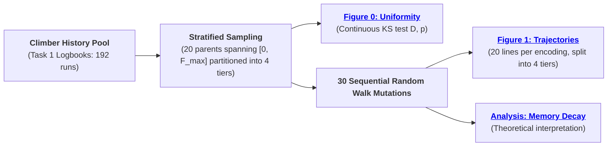
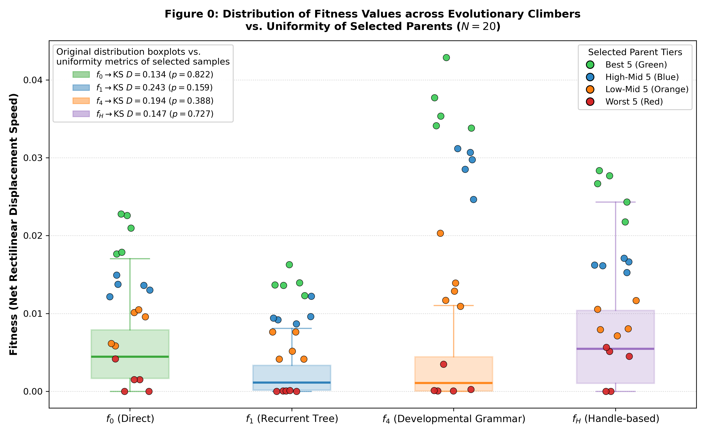
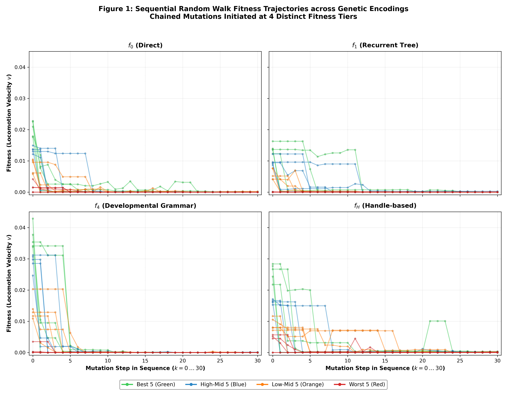

# Assignment 6: Fitness Landscape Exploration
## Task 3: Random Walk Fitness Landscape Exploration

### Objective

The objective of this task is to investigate the correlation length, mutational fragility, and genetic memory of the **fitness landscape for net rectilinear velocity** across different fitness levels for four genetic encodings ($f_0, f_1, f_4, f_H$). 

### Experiment Design & Pipeline

For each representation, $N = 20$ parent solutions are selected across the full discovered fitness spectrum $[0, F_{\max}]$, as it's done in [Task 1](../task1/report.md#uniform-fitness-sampling): fitness spectrum $[0, F_{\max}]$ is binned into $n_{\text{bins}} = 4$ equal-width bins with $k = 5$ samples per each bin, which naturally correspond to initial quality tiers. Starting from each solution, a sequential chained random walk of $30$ mutations is executed, rejecting infeasible mutants, to examine how random mutational drift unfolds at different fitness levels and measure the decay of evolved genetic information ("solution as memory").

### Distribution of Fitness Values across Evolutionary Climbers vs. Selected Parents

  
   

_**Figure 0**: Distribution of fitness values across unique evolutionary climbers (semi-transparent boxplots correspond to [Task 1: Figure 0](../task1/report.md#fig-distribution-parents-climbers) distributions) vs. the 20 stratified parent solutions (overlaid points colored by quality tier (5 per each)). Left legend reports the continuous 1-sample Kolmogorov-Smirnov test against theoretical uniform distribution_ $\mathcal{U}[0, F^{\text{enc}}_{\max}]$ _for the 20 selected parents for each encoding_ $\text{enc}$ _, confirming uniformity of the selected parent fitness values distribution._

### Random Walk Fitness Trajectories

  
   

_**Figure 1**: Sequential Random Walk Fitness Trajectories across 4 encodings. Chained mutations are initiated from 20 parent solutions per representation, and colored by their fitness tier (worst to best)_:
- $f_0$ exhibits rapid additive collapse as random perturbations break mechanical joints or neural connections.
- $f_1$ displays subtree modularity, where mutations either maintain neutrality (since most of them - 67.1% - apply to the neural net) or cause abrupt discrete drops when a branching node is severed; this can be compared to the stagnation effect, observed in [Task 1](../task1/report.md#comparison-f1).
- $f_4$ demonstrates rule-neutral plateaus followed by catastrophic morphospace collapse once a core developmental rule is altered. 
- $f_H$ exhibits high initial sensitivity of the _top-tier_ solutions due to coordinate handle mismatches in Euclidean binding space; _mid-tier_ solutions show **robustness** to mutations (probably due to the threshold effect, specific to this grammar) - similar effect exhibited in [Task 1](../task1/report.md#comparison-of-representations) - moreover, this also explains emergence of sudden peaks (as on the 21st iteration).

### "Solution as Memory" & Landscape Topology

1. **Decoherence of Genetic Memory**: Evolved high-fitness genotypes represent specialized "memory" storing phenotypic coordination discovered under selective pressure. In the absence of selection, unconstrained random walks produce exponential memory decay: fitness drops below 50% within $\approx 2..5$ mutational steps, collapsing to near zero ($< 10^{-4}$) by step 30 across all encodings.
2. **Low-Fitness Basin Entrapment**: Trajectories starting in low-fitness regions (red lines, Tier 4 on [Figure 1](#fig-trajectories-2x2)) remain confined to near-zero fitness throughout the entire 30-step walk. Without directional selection, purely stochastic drift cannot spontaneously assemble the synchronized mechanical and neural coordination required for locomotion.
3. **Landscape Ruggedness**: High-fitness peaks are surrounded by steep fitness cliffs (e.g. top-tier solutions in $f_1$ on [Figure 1](#fig-trajectories-2x2)). While developmental encodings ($f_1, f_4$) occasionally sustain neutral plateaus for a few steps, any structural perturbation to critical developmental rules or modular branches results in catastrophic collapse to the non-motile baseline (similar effect was observed in crossover in [Task 2: Figure 3](../task2/report.md#fig-example-offspring)).

In general, the trajectories directly reflect the operator-level properties discovered during 1-step neighborhood probing in [Task 1](../task1/report.md#table-neighborhood-characteristics): across all encodings, mutation operators exhibit a **severe destructive bias**, where worse mutations (54%–62%) drastically outnumber beneficial ones (1.5%–3.7%), while 35%–58% remain functionally neutral due to silent neural redundancy ([Task 1: Neural Redundancy](../task1/report.md#experimental-landscape-characterisation)). In chained random walks without selection, this asymmetry makes decay inevitable: continuous parametric shifts ($f_0$) induce gradual additive drift, discrete tree-node or grammar rewrite mutations ($f_1, f_4$) act as macro-mutations causing step-function drops, and Euclidean distance thresholds ($f_H$) provide initial phenotypic buffering against handle perturbations before experiencing threshold-crossing breakdown.

