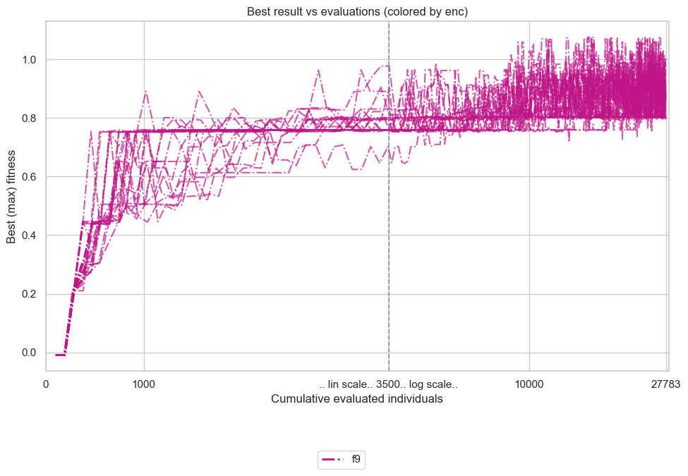
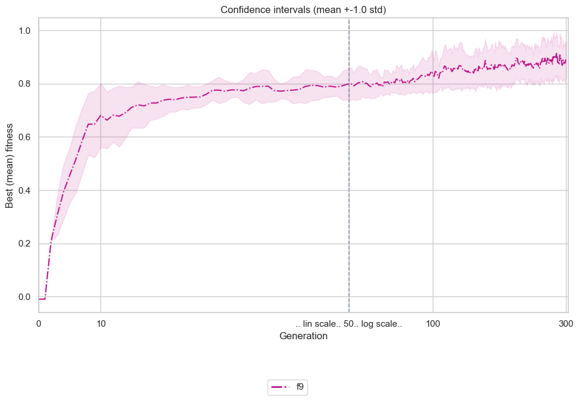
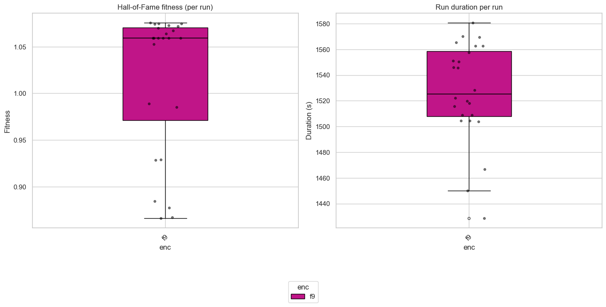
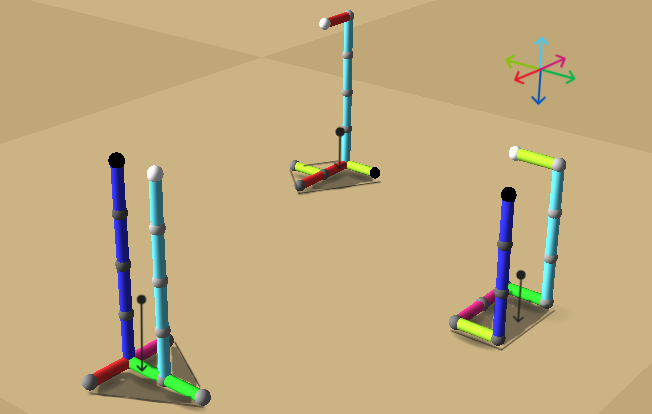
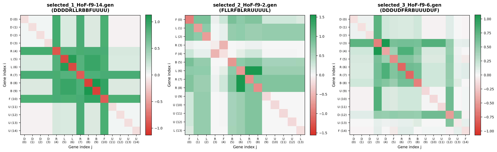
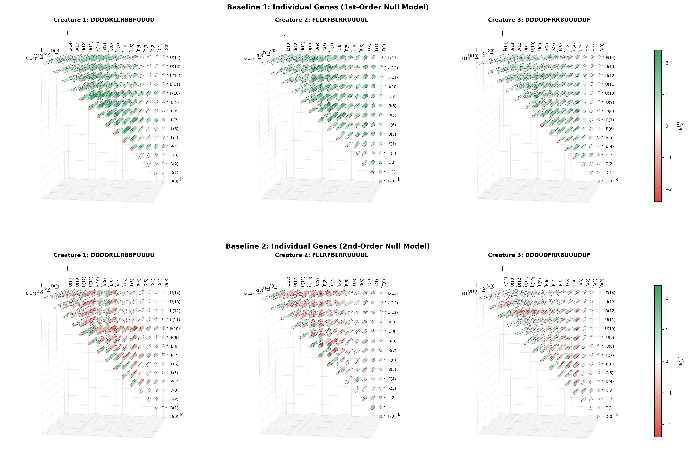

# Assignment 7: Epistasis & Gene Linkage
## Empirical Estimation and 2D Matrix Visualization of Epistasis in Evolutionary Robotics

**Epistasis** - is a phenomenon of interdependence of genes, where the effect of one gene on the phenotype depends on the presence of other genes (non-linear interactions between genes). _In the fitness fitness space_, epistasis measures whether a fitness function is _additively separable_. In the case of functions that are bounded from at least one side, the mapping between the genotype and phenotype space is naturally non-linear, and it is not possible to seperate this mapping into a sum of independent gene effects, as will be explored below.

The goal of this work is to investigate this phenomenon in evolutionary robotics, optimizing for _center-of-mass height_ (`vertpos`) in creatures evolved under directional encoding ($f_9$) with the following 6-character directional stick encoding semantics (each indicates a direction towards which the respective stick grows from the parent (last added) stick):
- `F` - forward
- `B` - backward
- `L` - left
- `R` - right
- `U` - up
- `D` - down

Firstly, [evolutionary optimization](#evolutionary-performance) is run under the following [parameters](#parameters-setup). Then 3 dissimilar individuals $s_1, s_2, s_3$ are selected from the final population $S^{G}, G=300$ of evolved creatures as follows:

$$\displaystyle s_1\mathrel{:=}\arg\max_{s \in S^{G}} \text{vertpos}$$

$$\displaystyle s_2\mathrel{:=}\arg\max_{s \in S^{G}\setminus\{s_1\}} \mathbb{d}(s, s_1)$$

$$\displaystyle s_3\mathrel{:=}\arg\max_{s \in S^{G}\setminus\{s_1, s_2\}} \min{\big(d(s, s_1), d(s, s_2)}\big)$$

where $d(g_1, g_2)$ denotes weighted Normalized Levenshtein Distance and Directional Composition Divergence (see the [script](select_dissimilar.py) for the exact implementation).

Secondly, [pairwise epistasis](#pairwise-epistasis) was [estimated](./estimate_epistasis.py) for the selected creatures based on the formula provided below. In the end, [epistasis between triplets of genes](#triple-epistasis) was estimated.

<a id="parameters-setup"></a>

<details>
<summary><h3 style="display:inline">Parameters &amp; Setup</h3></summary>
<br>

- **Optimization Criterion (Fitness)**: `vertpos` (maximizing vertical position of the mass center).
- **Genetic Representation**: [**$f_9$ Representation**](https://www.framsticks.com/a/al_geno_f9.html).
- **Simulation Environment ([`eval-allcriteria.sim;deterministic.sim;sample-period-2.sim;only-body.sim`](../../Framsticks55/data/))**:
  - **Deterministic Physics (`deterministic.sim`)**: Eliminates sensory, neural, and physical perturbation noise (`randinit: 0.0`, `nnoise: 0.0`, `bnoise_vel: 0.0`, `placement: 1`), enabling deterministic, noise-free single-trial evaluation (`evalcount: 1`).
  - **Sampling Period (`sample-period-2.sim`)**: Telemetry sampled every 2 simulation steps (`perfperiod: 2`) to ensure reliable vertical position evaluation throughout the creature lifespan.
  - **Morphological Focus (`only-body.sim`)**: Disables brain/neural mutations, ensuring evolutionary search focuses strictly on mechanical morphology.
- **Morphological & Syntactic Limits**:
  - **Max parts**: `-max_numparts 30`
- **EA Parameters**:
  - **Population size**: `--popsize 100`
  - **Generations**: `--generations 300`
  - **Selection**: `--tournament 5` (size 5)
  - **Crossover probability (`pxov`)**: `0.0` (pure asexual mutation-driven climb)
  - **Mutation probability (`pmut`)**: `0.9` (default Framsticks rate)
  - **Hall of Fame size**: `-hof_size 1`
  - **Replications**: `24` independent runs run in parallel on 24 physical cores

</details>

<a id="evolutionary-performance"></a>

<details>
<summary><h3 style="display:inline">Evolutionary Convergence &amp; Performance</h3></summary>
<br>

<p align="center">
  
  
  <br>
  <em><b>Figure 1a:</b> Hall of Fame best-fitness trajectories across 24 independent runs over 300 generations (left). <b>1b:</b> Mean best fitness across generations with confidence interval band (right).</em>
</p>

<p align="center">
  
  <br>
  <em><b>Figure 2:</b> Final Hall of Fame best fitness distribution and evaluation time across 24 replications.</em>
</p>

</details>

## Pairwise Epistasis

<a id = "pairwise-epistasis-formula"></a>

### Estimation

For an intact genotype $g$ of length $L$ with baseline fitness $F(g)$:
- $F(g \setminus \{i\})$ - fitness after disabling gene $i$.
- $F(g \setminus \{j\})$ -  fitness after disabling gene $j$.
- $F(g \setminus \{i, j\})$ - fitness after simultaneously disabling both genes $i$ and $j$.

The additive null model  $\mathcal{H}_0^1$ predicts the joint knockout effect to be the sum of independent single knockouts (this holds iff genes are independent) $ {\Delta F_{ij}}\equiv \Delta F_{i} + \Delta F_{j}$ , where:

$$\Delta F_i = F(g \setminus \{i\}) - F(g), \qquad \Delta F_j = F(g \setminus \{j\}) - F(g)$$

For two genes $i\ne j$, pairwise epistasis $\varepsilon_{i,j}$ measures the interaction deviation from additivity:

$$\varepsilon_{i,j} = \underbrace{\big[F(g \setminus \{i, j\}) - F(g)\big] }_{\Delta F_{ij}}- \big(\Delta F_i + \Delta F_j\big) \equiv F(g \setminus \{i, j\}) - F(g \setminus \{i\}) - F(g \setminus \{j\}) + F(g)$$

- $\varepsilon_{i,j} < 0 \implies$ negative epistasis (antagonistic breakdown / synthetic collapse - Red). The damage of loosing two genes is far worse than losing them independently
- $\varepsilon_{i,j} = 0 \implies$ additive / independent genes (White).
- $\varepsilon_{i,j} > 0 \implies$ positive epistasis (synergistic cooperation or functional redundancy / buffering - Green). If genes $i$ and $j$ perform similar task, losing both of them is less harmful than sum of individual knockouts.

In the calculated matrices, the diagonal ($i = j$) stores the single-gene knockout effect $\Delta F_i (\equiv \Delta F_{ii})$.


### Pairwise Epistasis Matrices (Task 1)

Using[ `select_dissimilar.py`](./select_dissimilar.py) (based on hybrid Levenshtein edit distance and 6D directional composition divergence), $k=3$ dissimilar tall structures were [selected](./selected/) from the evolutionary pool:
1. [`/*9*/DDDDRLLRBBFUUUU`](./selected/selected_1_HoF-f9-14.gen) ($F = 1.0755$, $L = 15$) - top champion with vertical trunk ($UUUU$) on an asymmetric base.
2. [`/*9*/FLLRFBLRRUUUUL`](./selected/selected_2_HoF-f9-2.gen) ($F = 0.9854$, $L = 14$) - wide-base tripod posture transitioning into a vertical mast.
3. [`/*9*/DDDUDFRRBUUUDUF`](./selected/selected_3_HoF-f9-6.gen) ($F = 0.8776$, $L = 15$) - alternating stabilizing loops with upward segments.

<p align="center">
  
  <br>

_**Figure 3:** Selected creatures (order preserved - left to right). All the creatures feature two main body parts: <u> a plinthed base</u> and a tall, erect <u>spine (chord)</u>. **Center of mass** of each creature (black fat dots) is located above the base. Shaded in dark regions denote <u>convex hulls formed by the support points (base sticks)</u>. **The criterion of static stability**: a projection of the center of mass onto the ground must lie strictly inside this convex hull (projections are indicated by black arrows). 6 arrows on the right indicate directions of stick growth._
</p>

<a id="fig-epistasis-matrices"></a>
<p align="center">
  
  <br>

_**Figure 4:** Pairwise epistasis matrices for_ $k=3$ _dissimilar tall structures arranged in a grid. Axis labels display gene letter and positional index. Off-diagonal elements show epistatic interaction_ $\varepsilon_{i,j}$, _while diagonal elements show single-gene knockout effects_ $\Delta F_i$.
</p>

### Interpretation of individual effects and interactions
<a id="table-epistasis-genes"></a>

|Phenotypic specialization| [Creature 1](./selected/selected_1_HoF-f9-14.gen)<br><code>/\*9\*/</code><code style="color: blue">DDDD</code><code style="color: purple">R</code><code style="color:red">LL</code><code style="color:purple">R</code><code style="color:green">BB</code><code style="color:lime">F</code><code style="color:#00bcd4">UUUU</code> | [Creature 2](./selected/selected_2_HoF-f9-2.gen)<br> <code>/\*9\*/</code><code style="color:lime">F</code><code style="color: red">LL</code><code style="color:purple">R</code><code style="color:lime">F</code><code style="color:green">B</code><code style="color:red">L</code><code style="color:purple">RR</code><code style="color:#00bcd4">UUUU</code><code style="color:red">L</code> | [Creature 3](./selected/selected_3_HoF-f9-6.gen)<br><code>/\*9\*/</code><code style="color: blue">DDD</code><code style="color:#00bcd4">U</code><code style="color:blue">D</code><code style="color:lime">F</code><code style="color:purple">R</code><code style="color:purple">R</code><code style="color:green">B</code><code style="color:#00bcd4">UUU</code><code style="color:blue">D</code><code style="color:#00bcd4">U</code><code style="color:lime">F</code> |
|-| ---------- | ---------- | ---------- |
|**Spine growth genes**| **0-3, 11-14**. The first 4 `D` and the last 4 `U` genes correspond to the <em><b><span style="color:blue">blue</span></b></em> and <em><b><span style="color:#00bcd4">cyan</span></b></em> _twin-chords_, directly responsible for the **height** of the creature. Having **two (redundant) copies** slightly increases the center of the mass height (`vertpos`). Deleting these letters individually only slightly decreases `vertpos` (rows and columns 0 to 3 and 11 to 14 are mainly zero value). |**9-13**. Since these genes program growth of the spine (`UUUUL`) only (increasing `vertpos`), they do not interact with each other, but their positive (in terms of `vertpos`) effect depends on _base_ genes (_0-3, 5-8_). In contrast to genes _9-12_, gene `L` serves stabilization purpose.|**0-3, 9-14**. Similar to the first (best) creature, there are 2 spines - <em><b><span style="color:blue">blue</span></b></em> and <em><b><span style="color:#00bcd4">cyan</span></b></em>, encoded by the genes at the ends of genome. In contrast to the former creature, 2 genes - `U`<sup>3</sup> and `D`<sup>12</sup> are the **key gene responsble for stability** of the creature, since both decrease long chords lengths (and hence <u>two pairs of genes <`U`<sup>3</sup>, `D`> and <`D`<sup>12</sup>, `U`> cancel out</u> - the same effect described in the second creature) - without them the creature overturns. **4**. The role of the gene `D`<sup>4</sup> is complementary to the gene `U`<sup>3</sup>, making it a **key gene responsible for morphological stability** - without this the <em><b><span style="color:blue">blue</span></b></em> chord would grow below _the base_ level, overturning the creature.
|**Plinth genes**|**4**. Gene `R` tells the direction to place the <em><b><span style="color:blue">blue</span></b></em> spine (`DDDD`) in the center of creature's plinth, critical to the stability of the creature - removing this gene places the center of mass allows small physical perturbations to overturn the creature, coloring the 4th row and column into <em style="color:MediumSeaGreen">light green</em> (definitely positive effect). However, removal of just one `D` places the center of mass safely above the base. **5-6**. These genes are responsible for symmetry of a base, and hence are **critical for stability** of the whole creature (interaction with genes _4-10_). Genes encoding _spines_ have little mutual effect with these two genes individually, the relationship will appear on [3D map of epistasis](#3d-epistasis-heatmaps). **7**. Gene `R` here is directly responsible for the symmetry of the base, placing the center of mass directly on the median segment of the base hull, yielding the highest "collaboration rate" (central <em style="color:MediumSeaGreen">light green cross</em> on the matrix) - for instance, removing any other spinal gene restores the balance; removing any base gene does nothing - the creature already overturned (in both cases $\Delta F_{7, i} \gg \Delta F_7 + \Delta F_i$). **8-9**. Each of two genes `B` allows a <em><b><span style="color:#00bcd4">cyan</span></b></em> chord to appear - without one of these genes the second spine grows inside the first one and the creature falls down. **10** Gene `F` places the <em><b><span style="color:#00bcd4">cyan</span></b></em> spine towards the center of the base, which is critical for stability (without this gene a creature overturns).| **0-2**. Gene `F` allows for one of the supporting sticks to emerge (**key for stabilization**), genes `LL` move this 'leg' towards the only place, where the position of the creature is stable. **3-4**. These genes alter the base form but in the way that does not affect the stability of the creature, thus these genes show **little epistasis** (~zero rows/colums). **5-8**. These genes influence the shape of _the base_ (`BL`) and position of _the spine_ on it (`RR`), and thus have positive epistasis with spine-genes. Gene <code>L<sup>6</sup></code> specifically has strong interaction with `RR` genes (<em style="color:green">dense green</em>), shortening the base extended by 2 _R_-direction genes, thus **making the base hull compact**. <u>Hence a pair `LR` cancels out (redundant subsequence)</u>|**5-8**. Genes `FRRB` form a U-shaped _base_, placing the center of mass strictly inside _the base hull_. Each gene here has an individual interaction with every other base gene.


<a id="base-spine-specialization"></a>

#### Specialization of genes extracted from pairwise epistasis matrix
[The table](#table-epistasis-genes) above can be summarized as follows: after canceling out redundant subsequences of genes, rows and columns can be grouped in two groups:
- Groups that have noticeable interaction (<em style="color:MediumSeaGreen">light green</em> to <em style="color:green">dense green</em> squares) correspond to the _plinthed base_ phenes (and have strong individual effects - <em style="color:lightcoral">bright red</em> diagonal elements)
- groups that has near-zero interaction with each other (`white` squares) and intermediate interactions (<em style="color:#cefad0">pale green</em>) with the other genes, form _spine_ phene groups. See [Figure 4](#fig-epistasis-matrices). 

#### Individual effects (red diagonals)
Individual (diagonal) effects $\Delta F_i$ take negative values since extraction of any gene from the genome leads to a decrease in the fitness depending on the role of the gene:
- gene $s$ encodes _spinal phene_ $\implies$ height slightly decreases (<em style="color:#faced0">pale red</em> diagonal elements): $\Delta F_s\approx 0$
- gene $b$ encodes a part of _base plinth_ $\implies$ creature immediately falls down yielding near-zero fitness (<em style="color:lightcoral">bright red</em> diagonal elements): $\Delta F_b\gg 0$

Since removing any _base_ gene overturns the creature, near-zero epistasis between _base_ and _spinal_ genes can be explained by individual effect of knocking out a base gene $b$

$$ \varepsilon_{b, s} \approx 0 \iff \Delta F_{b,s} \approx \Delta F_b + \Delta F_s \approx \Delta F_b$$

In rare cases (base gene `7` in Creature 1, green cross on [Figure 4](#fig-epistasis-matrices)) base and spinal genes strongly interact with each other.

## Triple Epistasis (Task 2)

### Estimation Formulas

#### Baseline 1
In the **first-order approach**, the null model $\mathcal{H}_0^1$ assumes independence and additive decomposability of individual fitness effects:

$$\mathcal{H}_0^1:\quad \Delta F_{ijk} = \Delta F_i + \Delta F_j + \Delta F_k$$

The triplet epistasis measures the total interaction deviation from additivity:

$$\varepsilon_{ijk}^{(1)} \mathrel{:=} \underbrace{\big[F(g \setminus \{i, j, k\}) - F(g)\big]}_{\Delta F_{ijk}} - (\Delta F_i + \Delta F_j + \Delta F_k) \equiv F(g \setminus \{i, j, k\}) - F(g \setminus \{i\}) - F(g \setminus \{j\}) - F(g \setminus \{k\}) + 2F(g)$$

#### Baseline 2
In the **second-order approach**, the null model $\mathcal{H}_0^2$ accounts for both single-gene knockouts $\Delta F_i$ and all pairwise epistatic interactions between the three genes $\varepsilon_{ij}$:

$$\mathcal{H}_0^2: \quad \Delta F_{ijk} = \Delta F_i + \Delta F_j + \Delta F_k + \underbrace{\varepsilon_{ij} + \varepsilon_{ik} + \varepsilon_{jk}}_{\text{2nd-order effects}} \equiv \Delta F_{ij} + \Delta F_{ik} + \Delta F_{jk} - (\Delta F_i + \Delta F_j + \Delta F_k)$$

This first expression is analogous to[ the exclusion-inclusion principle](https://en.wikipedia.org/wiki/Inclusion%E2%80%93exclusion_principle), which generalizes the definition of $n$-th order epistasiss $\varepsilon^{(n-1)}$ .

Hence epistasis is calculated as:

$$\varepsilon^{(2)}_{i,j,k} \mathrel{:=} \underbrace{\Delta F_{ijk}- \big(\Delta F_i + \Delta F_j + \Delta F_k\big)}_{\downarrow} - \big(\varepsilon_{ij} + \varepsilon_{ik} + \varepsilon_{jk}\big)$$

$$\varepsilon^{(2)}_{i,j,k} \equiv \varepsilon^{(1)}_{i,j,k} - (\varepsilon_{ij} + \varepsilon_{ik} + \varepsilon_{jk})$$

- $\varepsilon_{i,j,k} = 0 \implies$ pairwise decomposability: the interaction of genes is predictable from pairwise interactions, no higher-order effects.
- $|\varepsilon_{i,j,k}| > 0 \implies$ gene $k$ modulates interaction between $i$ and $j$.

_**Note:** In case of [Baseline 1](#baseline-1),_ $\varepsilon^{(1)}_{i,j,k} = 0$ _would mean that either the interaction is additive_ $(\varepsilon^{(1)}_{i,j,k}=\Delta F_i+\Delta F_j + \Delta F_k)$ _or pairwise-decomposable_ ($\varepsilon^{(2)}_{i,j,k}=\Delta F_{ijk}$). _Hence the definition of $\varepsilon^{(1)}$ yields less information than of_ $\varepsilon^{(2)}$.

In the calculated 3D tensors $(L \times L \times L)$ and [Figure 5](#3d-epistasis-heatmaps):
- The main diagonal ($i = j = k$) stores the single-gene knockout effect $\Delta F_i (\equiv \Delta F_{iii})$.
- Diagonal planes with 2 coincide indices (e.g. $(i=j, k)$) store [pairwise epistases](#fig-epistasis-matrices) $\varepsilon_{i,j}$.
- The off-diagonal entries ($i \ne j \ne k \ne i$) store the triplet epistasis ($\varepsilon_{ijk}^{(\cdot)}$). For a given knocked out gene $k$, a cross-section parallel to one of the coordinate planes - $\pi^k_{ij} = \{(i, j) |\text{fix }k\}$ - stores the pairwise epistases $\varepsilon^k_{ij}$ after gene $k$ is knocked out.

### 3D Epistasis Heatmaps

<p align="center">
  
  <br>

_**Figure 5:** 3D epistasis heatmaps (balls arranged in a 3D grid) for_ $k=3$ _dissimilar creatures, depicting_ $\varepsilon_{ijk}^{(\cdot)}\ | \ \forall i\le j\le k$. **Top row:** Baseline 1 (relative to individual genes_ $\varepsilon_{ijk}^{(1)}$). _**Bottom row:** Baseline 2 (relative to pairwise interactions_ $\varepsilon_{ijk}^{(2)}$). _**Colormap:** Green - positive synergy / buffering; Red - negative / synthetic breakdown. The scale of the colormap differs from the one used in 2D-epistatic visualisations. A semiplane on the visilbe side of the pyramides coincide with the upper triangle of epistasis matrices ([Figure 4](#fig-epistasis-matrices))._
</p>

### Epistasis Matrix Sums Comparison

To better understand the relative contribution of pairwise and triplet epistasis, the following two metrics can be calculated:
- **Directedness** - ratio of the sum of all triplet epistasis values to the sum of the absolute values of all triplet epistasis values. Values close to $\pm 1$ indicate that the contribution of triplet epistasis is predominantly synergistic/buffering or antagonistic/disruptive, respectively:

$$\text{dir }\varepsilon^{(\cdot)} \mathrel{:=} \frac{\sum \varepsilon^{(\cdot)}}{\sum \lvert\varepsilon^{(\cdot)}\rvert} \in [-1; 1]$$

- **Mean absolute triplet epistasis** (this value should be considered with respect to $\max \Delta F$ which is ommited for simplification):

$$\lvert\bar{\varepsilon}^{(\cdot)}\rvert \mathrel{:=} \frac{1}{\binom{L}{3}} \sum \lvert\varepsilon^{(\cdot)}\rvert$$

<a id="table-3d-epistasis-sums"></a>

| Creature | Genotype | $L$ | Triplet Count<br>$\binom{L}{3}$ |<br>$\sum \varepsilon^{(1)}$ | Baseline<br>$\sum \lvert\varepsilon^{(1)}\rvert$ |1<br>$\text{dir}\varepsilon^{(1)}$ |<br>$\lvert\bar{\varepsilon}^{(1)}\rvert$ |<br>$\sum \varepsilon^{(2)}$ | Baseline<br>$\sum \lvert\varepsilon^{(2)}\rvert$ |2<br>$\text{dir}\varepsilon^{(2)}$ |<br>$\lvert\bar{\varepsilon}^{(2)}\rvert$ |
| :---: | :--- | :---: | :---: | :---: | :---: | :---: | :---: | :---: | :---: | :---: | :---: |
| 1 | [`/*9*/DDDDRLLRBBFUUUU`](./selected/selected_1_HoF-f9-14.gen) | 15 | 455 | **+375.02** | **377.74** | <span style="color: #006837;">+0.993</span> | <span style="color: #33815c;">0.830</span> | **-171.78** | 224.35 | <span style="color: #b94251;">-0.766</span> | <span style="color: #c7ccc9;">0.493</span> |
| 2 | [`/*9*/FLLRFBLRRUUUUL`](./selected/selected_2_HoF-f9-2.gen) | 14 | 364 | +344.29 | 344.55 | <b><span style="color: #006837;">+0.999</span></b> | <b><span style="color: #006837;">0.947</span></b> | -149.80 | 183.42 | <b><span style="color: #b73949;">-0.817</span></b> | <span style="color: #c2c9c6;">0.504</span> |
| 3 | [`/*9*/DDDUDFRRBUUUDUF`](./selected/selected_3_HoF-f9-6.gen) | 15 | 455 | +274.31 | 276.66 | <span style="color: #026938;">+0.992</span> | <span style="color: #94b2a4;">0.608</span> | -62.25 | **142.43** | <span style="color: #c38088;">-0.437</span> | <b><span style="color: #c69198;">0.313</span></b> |


### Interpretation of 3D Triplet Epistasis

1. **Baseline 1**:
    - When evaluated against independent single-gene effects, all creatures exhibit overwhelming positive epistasis (nearly all green balls, $\text{dir} \varepsilon^{(1)} \approx + 1$).
    - This occurs because removing any single _base_ gene (e.g. anchor <code>R<sup>4</sup></code>, symmetry genes <code>LL<sup>5-6</sup></code>, or stabilizer <code>F<sup>10</sup></code> in Creature 1) causes the structure to topple over ($\Delta F \approx -1.0$). _Summing three such single knockout penalties predicts an impossible fitness penalty_ of $-3.0$, whereas the simultaneous triple knockout cannot reduce fitness below ground level ($F=0$). Thus, the actual **fitness is buffered against cumulative linear collapse** ($\Delta F_{ijk} \gg \Delta F_i + \Delta F_j + \Delta F_k$). 
    - This suggests that even in such simple ($f_9$) creatures the hypothesis about triple linearity $\mathcal{H}^1_0$ (see [Baseline 1](#baseline-1)) does not hold and **this epistatic model is not adequate and yields little information** (excluded pairwise effects, almost constant directedness $\text{dir }\varepsilon^{(1)}\approx 1$) [_in the current setup_](#parameters-setup).

2. **Baseline 2 ($\sum \varepsilon^{(2)} < 0$, Irreducible Negative 3-Way Epistasis)**:
   - Once all pairwise interactions are accounted for, the total epistasis flips to negative (prominent red clusters, $\text{dir }\varepsilon^{(2)} \ll 0$).
   - As mentioned in [Task 1](#base-spine-specialization), **_base_ genes** (e.g. `4-10` in Creature 1, or `0-8` in Creature 2, see the [Table](#table-epistasis-genes)) **have strong pairwise collaborations** with each other and intermediate collaboration with the _spine_ encoding genes. When one of _base_ genes $b$ is knocked out, in most cases creature topples over: 
      - knocking out two spinal genes will take no effect (white bars on 3D map: main terms in the epistasis formula are $F_{b,b', s} -\Delta F_{b}\approx 0$); 
      - knocking out a pair of _base_ and _spinal_ genes $(b', s)$ pproduces diminishing marginal damage compared to what the pairwise sum predicts, manifesting as negative third-order interaction (due to 2 individual base effects $ \Delta F_{b, b', s} - (\Delta F_{b'} + \Delta F_{b}) \ll 0$).
      - In some cases knocking two base genes have buffered knocking out a third spinal gene from toppling the creature over: in creature 1 knocking out any of genes 0-3 once two genes 5-6 are knocked out, preserves stability of the creature - green row on a 3D map.
      - Analagous type of buffering happens in the same creature when _base_ gene 8/9 is knocked out and then 2 "parallel" spinal genes (0-3 and 11-14) must be dropped out to preserve stability of the creature. 
      - Similar to the effect of knocking out 2 bases, knocking out 3 bases may yield the worst result in case of strong pairwise dependency: knocking genes 6-8 in Creature 2 yields the formula with multiple dominating negative terms ($-\varepsilon$) in the epistasis formula.

   - Creature 3 features the lowest magnitude of 3-way epistasis ($|\sum \varepsilon^{(2)}| = 62.25$ vs $171.78$ in Creature 1) because its alternating loops (`DDDUDFRRBUUUDUF`) distribute structural stabilization across several self-canceling sub-segments (`UD`, `DU`), making its higher-order genetic interactions more modular: this creature features the least amount of triple epistatic effects.

   - Empirical examination of the Baseline 2 3D maps suggests that positive epistasis - green areas of off-diagonal entries - provide information regarding buffering interaction between triplets of genes. For instance, knocking out 3 genes 3-4 and 1 or 2 in creature 3 preserves its stability, i.e. the creature doesn't topple down. Negative and neutral values provide little information regarding triple interactions due to positive pairwise epistases. 

  

## How to Run
```powershell

#### 0. Activate environment
cd '.\Evolutionary Design\'  # if running from the BIA folder
conda activate framsticks

#### 1. Parallel Evolutionary Run (24 Replications on 24 Cores)
python scripts\run_parallel.py `
    --script scripts\FramsticksEvolutionScheduled.py `
    --frams-path Framsticks55 `
    --sim "eval-allcriteria.sim;deterministic.sim;sample-period-2.sim;only-body.sim" `
    --opt vertpos `
    --max-numparts 30 `
    --popsize 100 `
    --generations 300 `
    --genformats 9 `
    --num-experiments 24 `
    --workers 24 `
    --out "assignments\Assignment 7 - Epistasis & Gene linkage\runs" `
    --stats-dir "assignments\Assignment 7 - Epistasis & Gene linkage\stats"

#### 2. Generate Evolutionary Plots
python scripts\analyze_hof.py `
    --headless `
    --logbook-dirs "assignments\Assignment 7 - Epistasis & Gene linkage\stats\2026-11-02_03" `
    --outdir "assignments\Assignment 7 - Epistasis & Gene linkage\results\evolution"

#### 3. Select Dissimilar Structures
python "assignments\Assignment 7 - Epistasis & Gene linkage\select_dissimilar.py" `
    --runs-dir "assignments\Assignment 7 - Epistasis & Gene linkage\runs" `
    --k 3

#### 4. Estimate and Visualize Pairwise Epistasis Matrices (Task 1)
python "assignments\Assignment 7 - Epistasis & Gene linkage\estimate_epistasis.py" `
    --frams-path Framsticks55 `
    --genotypes-folder "assignments\Assignment 7 - Epistasis & Gene linkage\selected" `
    --out "assignments\Assignment 7 - Epistasis & Gene linkage\results\epistasis\epistasis_matrices.png"

#### 5. Estimate and Visualize 3D Triplet Epistasis (Task 2)
python "assignments\Assignment 7 - Epistasis & Gene linkage\estimate_3d_epistasis.py" `
    --frams-path Framsticks55 `
    --genotypes-folder "assignments\Assignment 7 - Epistasis & Gene linkage\selected"
```

