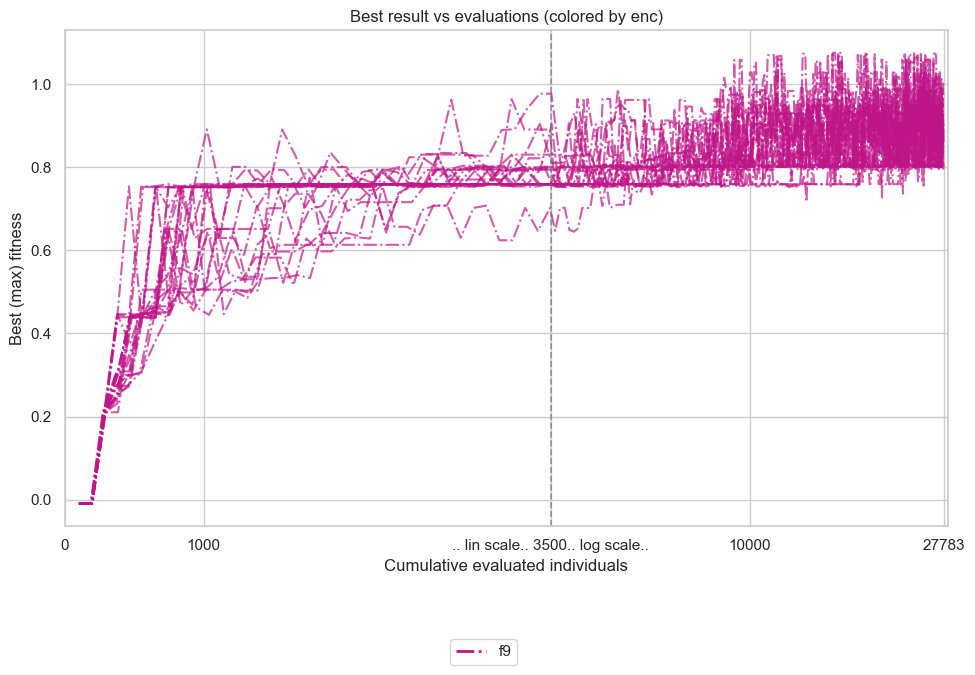
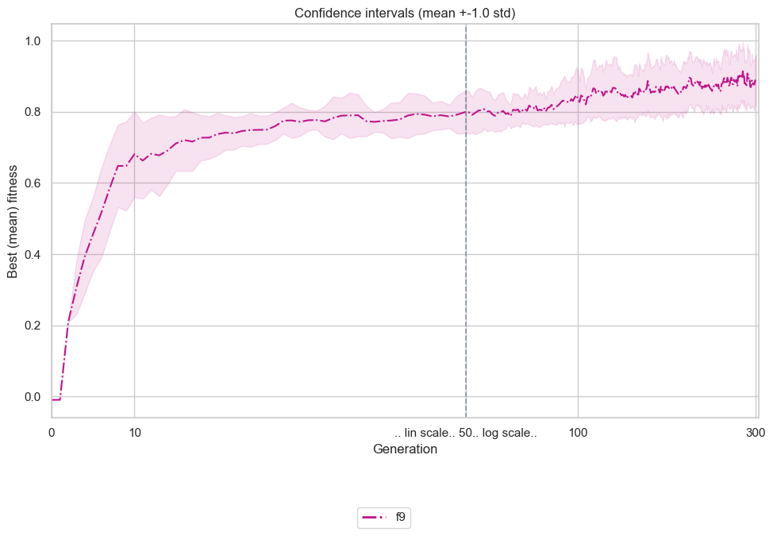
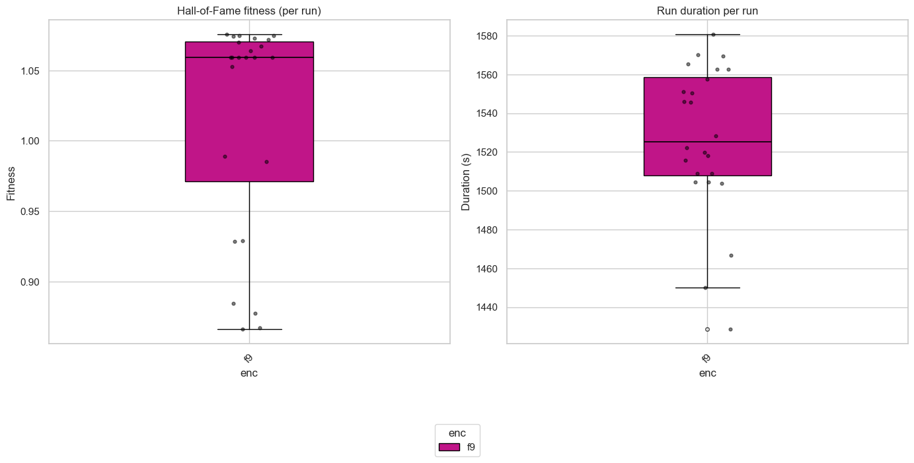
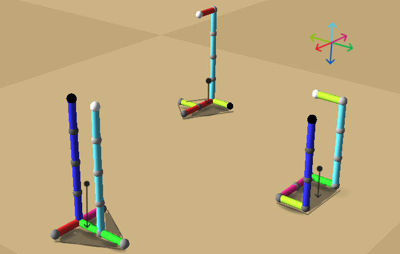
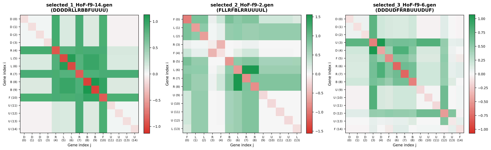

# Assignment 7: Epistasis & Gene Linkage
## Task 1

The goal of this work is to investigate the phenomenon of **epistasis** (non-linear interactions between genes) in evolutionary robotics, optimizing for _center-of-mass height_ (`vertpos`) in creatures evolved under directional encoding ($f_9$) with the following 6-character directional stick encoding semantics (each indicates a direction towards which the respective stick grows from the parent (last added) stick).

Firstly, [evolutionary optimization](#evolutionary-performance) is run under the following [parameters](#parameters-setup). Then 3 dissimilar individuals $s_1, s_2, s_3$ are selected from the final population $S^{G}, G=300$ of evolved creatures as follows:

$$\displaystyle s_1\mathrel{:=}\arg\max_{s \in S^{G}} \text{vertpos}$$

$$\displaystyle s_2\mathrel{:=}\arg\max_{s \in S^{G}\setminus\{s_1\}} \mathbb{d}(s, s_1)$$

$$\displaystyle s_3\mathrel{:=}\arg\max_{s \in S^{G}\setminus\{s_1, s_2\}} \min{\big(d(s, s_1), d(s, s_2)}\big)$$

where $d(g_1, g_2)$ denotes weighted Normalized Levenshtein Distance and Directional Composition Divergence (see the [script](select_dissimilar.py) for the exact implementation). 

Secondly, [pairwise epistasis](#epistasis-estimation) was [estimated](./estimate_epistasis.py) for the selected creatures based on the formula provided below.

<h3 style="display:inline">Parameters &amp; Setup</h3>

 

- **Fitness**: `vertpos` 
- **Genetic Representation**: [$f_9$](https://www.framsticks.com/a/al_geno_f9.html)
- **Simulation Environment ([`eval-allcriteria.sim;deterministic.sim;sample-period-2.sim;only-body.sim`](../../Framsticks55/data/))**
- **Max parts**: `-max_numparts 30`
- **EA Parameters**:
  - **Population size**: `--popsize 100`
  - **Generations**: `--generations 300`
  - **Selection**: `--tournament 5` 
  - **Crossover probability (`pxov`)**: `0.0` 
  - **Mutation probability (`pmut`)**: `0.9` 
  - **Hall of Fame size**: `-hof_size 1`
  - **Replications**: `24` independent runs run in parallel on 24 physical cores

<h3 style="display:inline">Evolutionary Convergence &amp; Performance</h3>

 

  
  
   
  <em><b>Figure 1a:</b> Hall of Fame best-fitness trajectories across 24 independent runs over 300 generations (left). <b>1b:</b> Mean best fitness across generations with confidence interval band (right).</em>

  
   
  <em><b>Figure 2:</b> Final Hall of Fame best fitness distribution and evaluation time across 24 replications.</em>

### Epistasis Estimation Formula

For an intact genotype $g$ of length $L$ with baseline fitness $F(g)$:
- $F(g \setminus \{i\})$ - fitness after disabling gene $i$.
- $F(g \setminus \{j\})$ -  fitness after disabling gene $j$.
- $F(g \setminus \{i, j\})$ - fitness after simultaneously disabling both genes $i$ and $j$.

The additive null model predicts the joint knockout effect to be the sum of independent single knockouts (this holds iff genes are independent) ${\Delta F_{ij}}\equiv \Delta F_{i} + \Delta F_{j}$, where:

$$\Delta F_i = F(g \setminus \{i\}) - F(g), \qquad \Delta F_j = F(g \setminus \{j\}) - F(g)$$

For two genes $i\ne j$, pairwise epistasis $\varepsilon_{i,j}$ measures the interaction deviation from additivity:

$$\varepsilon_{i,j} = \underbrace{\big[F(g \setminus \{i, j\}) - F(g)\big] }_{\Delta F_{ij}}- \big(\Delta F_i + \Delta F_j\big) = F(g \setminus \{i, j\}) - F(g \setminus \{i\}) - F(g \setminus \{j\}) + F(g)$$

- $\varepsilon_{i,j} = 0 \implies $ additive / independent genes (White).
- $\varepsilon_{i,j} > 0 \implies$ positive epistasis (synergistic cooperation or functional redundancy / buffering - Green).
- $\varepsilon_{i,j} < 0 \implies$ negative epistasis (antagonistic breakdown / synthetic collapse - Red).

In the calculated matrices, the diagonal ($i = j$) stores the single-gene knockout effect $\Delta F_i (\equiv \Delta F_{ii})$.

### Pairwise Epistasis Matrices (Task 1)

Using[ `select_dissimilar.py`](./select_dissimilar.py) (based on hybrid Levenshtein edit distance and 6D directional composition divergence), $k=3$ dissimilar tall structures were [selected](./selected/) from the evolutionary pool:
1. [`/*9*/DDDDRLLRBBFUUUU`](./selected/selected_1_HoF-f9-14.gen) ($F = 1.0755$, $L = 15$) - top champion with vertical trunk ($UUUU$) on an asymmetric base.
2. [`/*9*/FLLRFBLRRUUUUL`](./selected/selected_2_HoF-f9-2.gen) ($F = 0.9854$, $L = 14$) - wide-base tripod posture transitioning into a vertical mast.
3. [`/*9*/DDDUDFRRBUUUDUF`](./selected/selected_3_HoF-f9-6.gen) ($F = 0.8776$, $L = 15$) - alternating stabilizing loops with upward segments.

  
   

_**Figure 3:** Selected creatures (order preserved - left to right). All the creatures feature two main body parts: <u> a plinthed base</u> and a tall, erect <u>spine (chord)</u>. **Center of mass** of each creature (black fat dots) is located above the base. Shaded in dark regions denote <u>convex hulls formed by the support points (base sticks)</u>. **The criterion of static stability**: a projection of the center of mass onto the ground must lie strictly inside this convex hull (projections are indicated by black arrows)._ 

  
   

_**Figure 4:** Pairwise epistasis matrices for_ $k=3$ _dissimilar tall structures arranged in a grid. Axis labels display gene letter and positional index. Off-diagonal elements show epistatic interaction_ $\varepsilon_{i,j}$, _while diagonal elements show single-gene knockout effects_ $\Delta F_i$. _Note: colorbars have different ranges for different matrices._

### Interpretation of individual effects and interactions

#### Phenotypic specialization - **Spine growth genes**
| [Creature 1](./selected/selected_1_HoF-f9-14.gen) <code>/\*9\*/</code><code style="color: blue">DDDD</code><code style="color: purple">R</code><code style="color:red">LL</code><code style="color:purple">R</code><code style="color:green">BB</code><code style="color:lime">F</code><code style="color:darkcyan">UUUU</code> | [Creature 2](./selected/selected_2_HoF-f9-2.gen)  <code>/\*9\*/</code><code style="color:lime">F</code><code style="color: red">LL</code><code style="color:purple">R</code><code style="color:lime">F</code><code style="color:green">B</code><code style="color:red">L</code><code style="color:purple">RR</code><code style="color:darkcyan">UUUU</code><code style="color:red">L</code> | [Creature 3](./selected/selected_3_HoF-f9-6.gen) <code>/\*9\*/</code><code style="color: blue">DDD</code><code style="color:darkcyan">U</code><code style="color:blue">D</code><code style="color:lime">F</code><code style="color:purple">R</code><code style="color:purple">R</code><code style="color:green">B</code><code style="color:darkcyan">UUU</code><code style="color:blue">D</code><code style="color:darkcyan">U</code><code style="color:lime">F</code> | 
|---------- | ---------- | ---------- | 
|**0-3, 11-14**. The first 4 `D` and the last 4 `U` genes correspond to the <em>blue</em> and <em>cyan</em> _twin-chords_, directly responsible for the **height** of the creature. Having **two (redundant) copies** slightly increases the center of the mass height (`vertpos`). Deleting these letters individually only slightly decreases `vertpos` (rows and columns 0 to 3 and 11 to 14 are mainly zero value). |**9-13**. Since these genes program growth of the spine (`UUUUL`) only (increasing `vertpos`), they do not interact with each other, but their positive (in terms of `vertpos`) effect depends on _base_ genes (_0-3, 5-8_). In contrast to genes _9-12_, gene `L` serves stabilization purpose.|**0-3, 9-14**. Similar to the first (best) creature, there are 2 spines - <em>blue</em> and <em>cyan</em>, encoded by the genes at the ends of genome. In contrast to the former creature, 2 genes - `U`3 and `D`12 are the **key gene responsble for stability** of the creature, since both decrease long chords lengths (and hence <u>two pairs of genes <`U`3, `D`> and <`D`12, `U`> cancel out</u> - the same effect described in the second creature) - without them the creature overturns. **4**. The role of the gene `D`4 is complementary to the gene `U`3, making it a **key gene responsible for morphological stability** - without this the <em>blue</em> chord would grow below _the base_ level, overturning the creature. 

#### Phenotypic specialization - **Plinth genes**

| Creature 1 | Creature 2 | Creature 3 | 
|---------- | ---------- | ---------- | 
|**4**. Gene `R` tells the direction to place the <em>blue</em> spine (`DDDD`) in the center of creature's plinth, critical to the stability of the creature - removing this gene places the center of mass allows small physical perturbations to overturn the creature, coloring the 4th row and column into green (definitely positive effect). However, removal of just one `D` places the center of mass safely above the base. **5-6**. These genes are responsible for symmetry of a base, and hence are **critical for stability** of the whole creature (interaction with genes _4-10_). Genes encoding _spines_ have little mutual effect with these two genes individually, the relationship will appear on 3D map of epistasis. **7**. Gene `R` here is directly responsible for the symmetry of the base, placing the center of mass directly on the median segment of the base hull, yielding the highest "collaboration rate" (central green cross on the matrix). **8-9**. Each of two genes `B` allows <em>cyan</em> chord to be placed - without one of these two genes the second spine disappears and `vertpos` drops noticeably. **10** Gene `F` places the <em>cyan</em> spine towards the center of the base, which is critical for stability (without this gene a creature overturns).| **0-2**. Gene `F` allows for one of the supporting sticks to emerge (**key for stabilization**), genes `LL` move this 'leg' towards the only place, where the position of the creature is stable. **3-4**. These genes alter the base form but in the way that does not affect the stability of the creature, thus these genes show **little epistasis** (~zero rows/colums). **5-8**. These genes influence the shape of _the base_ (`BL`) and position of _the spine_ on it (`RR`), and thus have positive epistasis with spine-genes. Gene `L` specifically has strong interaction with `RR` genes, shortening the base extended by 2 _R_-direction genes, thus **making the base hull compact**. <u>Hence a pair `LR` cancels out (redundant subsequence)</u>|**5-8**. Genes `FRRB` form a U-shaped _base_, placing the center of mass strictly inside _the base hull_. Each gene here has an individual interaction with every other base gene.

#### Specialization of genes extracted from pairwise epistasis matrix
[The table](#table-epistasis-genes) above can be summarized as follows: after canceling out redundant subsequences of genes, rows and columns that form bright `green` squares correspond to the _plinthed base_ phenes and the rows and columns that has near-zero interaction with each other (`white` squares) and intermediate interactions (`light green`) with the other genes, form _spine_ phene groups. See [Figure 4](#fig-epistasis-matrices)

#### Individual effects (red diagonals)
Individual (diagonal) effects $\Delta F_i$ take negative values since extraction of any gene from the genome leads to a decrease in the fitness depending on the role of the gene:
- gene encodes _spinal phene_ $\implies$ heigh slightly decreases
- gene encodes a part of _plinth_ $\implies$ creature immediately falls down yielding near-zero fitness.