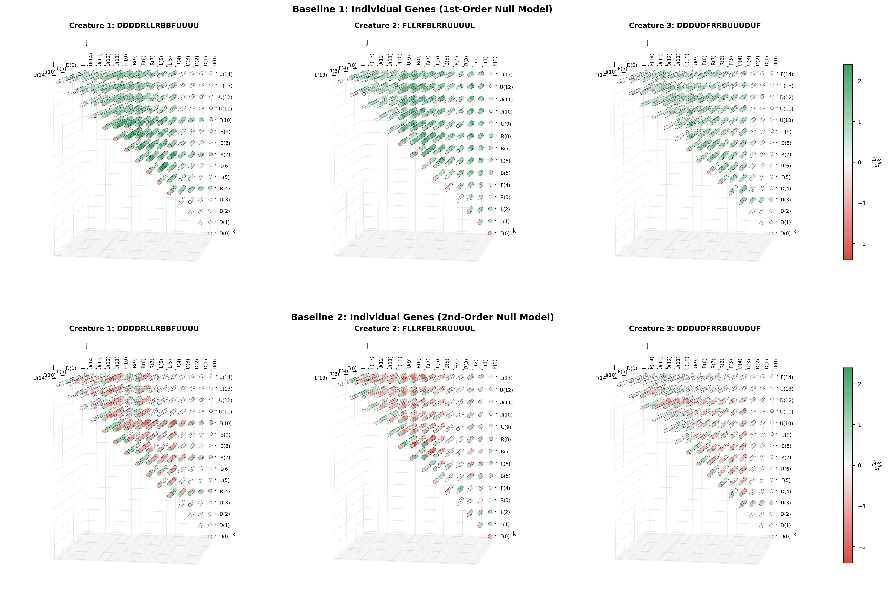

# Assignment 7: Epistasis & Gene Linkage
## Task 2

## Triple Epistasis (Task 2)

### Estimation Formulas

#### Baseline 1
In the **first-order approach**, the null model $\mathcal{H}_0^1$ assumes independence and additive decomposability of individual fitness effects:

$$\mathcal{H}_0^1:\quad \Delta F_{ijk} = \Delta F_i + \Delta F_j + \Delta F_k$$

The triplet epistasis measures the total interaction deviation from additivity:

$$\varepsilon_{ijk}^{(1)} \mathrel{:=} \underbrace{\big[F(g \setminus \{i, j, k\}) - F(g)\big]}_{\Delta F_{ijk}} - (\Delta F_i + \Delta F_j + \Delta F_k) \equiv F(g \setminus \{i, j, k\}) - F(g \setminus \{i\}) - F(g \setminus \{j\}) - F(g \setminus \{k\}) + 2F(g)$$

#### Baseline 2
In the **second-order approach**, the null model $\mathcal{H}_0^2$ accounts for both single-gene knockouts $\Delta F_i$ and all pairwise epistatic interactions between the three genes $\varepsilon_{ij}$:

$$\mathcal{H}_0^2: \quad \Delta F_{ijk} = \Delta F_i + \Delta F_j + \Delta F_k + \underbrace{\varepsilon_{ij} + \varepsilon_{ik} + \varepsilon_{jk}}_{\text{2nd-order effects}} \equiv \Delta F_{ij} + \Delta F_{ik} + \Delta F_{jk} - (\Delta F_i + \Delta F_j + \Delta F_k)$$

This first expression is analogous to[ the exclusion-inclusion principle](https://en.wikipedia.org/wiki/Inclusion%E2%80%93exclusion_principle), which generalizes the definition of $n$-th order epistasis $\varepsilon^{(n-1)}$.

Hence epistasis is calculated as:

$$\varepsilon^{(2)}_{i,j,k} \mathrel{:=} \underbrace{\Delta F_{ijk}- \big(\Delta F_i + \Delta F_j + \Delta F_k\big)}_{\downarrow} - \big(\varepsilon_{ij} + \varepsilon_{ik} + \varepsilon_{jk}\big)$$

$$\varepsilon^{(2)}_{i,j,k} \equiv \varepsilon^{(1)}_{i,j,k} - (\varepsilon_{ij} + \varepsilon_{ik} + \varepsilon_{jk})$$

- $\varepsilon^{(2)}_{i,j,k} = 0 \implies$ pairwise decomposability: the interaction of genes is predictable from pairwise interactions, no higher-order effects.
- $|\varepsilon^{(2)}_{i,j,k}| > 0 \implies$ gene $k$ modulates interaction between $i$ and $j$.

_**Note:** In case of [Baseline 1](#baseline-1),_ $\varepsilon^{(1)}_{i,j,k} = 0$ _would mean either that the interaction is strictly additive_ $(\Delta F_{ijk} = \Delta F_i + \Delta F_j + \Delta F_k)$ _or that unaccounted higher-order effects cancel out existing pairwise ones_ $(\varepsilon^{(2)}_{i,j,k} = - (\varepsilon_{ij} + \varepsilon_{ik} + \varepsilon_{jk}))$. _Hence, the definition of $\varepsilon^{(1)}$ yields less distinct information than $\varepsilon^{(2)}$. In terms of **new** information, Baseline 2 explicitly factors out known pairwise effects, while Baseline 1 leaves them entangled with possible triplet effects._

In the calculated 3D tensors $(L \times L \times L)$ and [Figure 5](#3d-epistasis-heatmaps):
- The main diagonal ($i = j = k$) stores the single-gene knockout effect $\Delta F_i (\equiv \Delta F_{iii})$.
- Diagonal planes with 2 coincide indices (e.g. $(i=j, k)$) store [pairwise epistases](#fig-epistasis-matrices) $\varepsilon_{i,j}$.
- The off-diagonal entries ($i \ne j \ne k \ne i$) store the triplet epistasis ($\varepsilon_{ijk}^{(\cdot)}$). For a given knocked out gene $k$, a cross-section parallel to one of the coordinate planes - $\pi^k_{ij} = \{(i, j) |\text{fix }k\}$ - stores the pairwise epistases $\varepsilon^k_{ij}$ after gene $k$ is knocked out.

### 3D Epistasis Heatmaps

  
   

_**Figure 5:** 3D epistasis heatmaps (balls arranged in a 3D grid) for_ $k=3$ _dissimilar creatures, depicting_ $\varepsilon_{ijk}^{(\cdot)}\ | \ \forall i\le j\le k$. **Top row:** Baseline 1 (relative to individual genes_ $\varepsilon_{ijk}^{(1)}$). _**Bottom row:** Baseline 2 (relative to pairwise interactions_ $\varepsilon_{ijk}^{(2)}$). _**Colormap:** Green - positive synergy / buffering; Red - negative / synthetic breakdown. The scale of the colormap differs from the one used in 2D-epistatic visualisations. A semiplane on the visible side of the pyramids coincides with the upper triangle of epistasis matrices ([Figure 4](#fig-epistasis-matrices))._

### Epistasis Matrix Sums Comparison

To better understand the relative contribution of pairwise and triplet epistasis, the following two metrics can be calculated:
- **Directedness** - ratio of the sum of all triplet epistasis values to the sum of the absolute values of all triplet epistasis values. Values close to $\pm 1$ indicate that the contribution of triplet epistasis is predominantly synergistic/buffering or antagonistic/disruptive, respectively:

$$\text{dir }\varepsilon^{(\cdot)} \mathrel{:=} \frac{\sum \varepsilon^{(\cdot)}}{\sum \lvert\varepsilon^{(\cdot)}\rvert} \in [-1; 1]$$

- **Mean absolute triplet epistasis** (this value should be considered with respect to $\max \Delta F$ which is ommited for simplification):

$$\lvert\bar{\varepsilon}^{(\cdot)}\rvert \mathrel{:=} \frac{1}{\binom{L}{3}} \sum \lvert\varepsilon^{(\cdot)}\rvert$$

| Creature | Genotype | $L$ | Triplet Count $\binom{L}{3}$ | $\sum \varepsilon^{(1)}$ | Baseline $\sum \lvert\varepsilon^{(1)}\rvert$ |1 $\text{dir}\varepsilon^{(1)}$ | $\lvert\bar{\varepsilon}^{(1)}\rvert$ | $\sum \varepsilon^{(2)}$ | Baseline $\sum \lvert\varepsilon^{(2)}\rvert$ |2 $\text{dir}\varepsilon^{(2)}$ | $\lvert\bar{\varepsilon}^{(2)}\rvert$ |
| :---: | :--- | :---: | :---: | :---: | :---: | :---: | :---: | :---: | :---: | :---: | :---: |
| 1 | [`/*9*/DDDDRLLRBBFUUUU`](./selected/selected_1_HoF-f9-14.gen) | 15 | 455 | **+375.02** | **377.74** | +0.993 | 0.830 | **-171.78** | 224.35 | -0.766 | 0.493 |
| 2 | [`/*9*/FLLRFBLRRUUUUL`](./selected/selected_2_HoF-f9-2.gen) | 14 | 364 | +344.29 | 344.55 | <b>+0.999</b> | <b>0.947</b> | -149.80 | 183.42 | <b>-0.817</b> | 0.504 |
| 3 | [`/*9*/DDDUDFRRBUUUDUF`](./selected/selected_3_HoF-f9-6.gen) | 15 | 455 | +274.31 | 276.66 | +0.992 | 0.608 | -62.25 | **142.43** | -0.437 | <b>0.313</b> |

### Interpretation of 3D Triplet Epistasis

1. **Baseline 1 vs Baseline 2**:
    - <u><b>Baseline 2</b> turned out to be distinctly more useful for discovering new higher-order information regarding gene triplets.</u>
    - Under **Baseline 1**, the null model $\mathcal{H}_0^1$ assumes pure additivity from single-gene knockouts. When evaluated against independent single-gene effects, all creatures exhibit overwhelming positive epistasis (nearly all green balls, $\text{dir} \varepsilon^{(1)} \approx + 1$).
    - This occurs because removing any single _base_ gene (e.g. anchor <code>R4</code>, symmetry genes <code>LL5-6</code>, or stabilizer <code>F10</code> in Creature 1) causes the structure to topple over ($\Delta F \approx -1.0$). _Summing three such single knockout penalties predicts an impossible fitness penalty_ of $-3.0$, whereas the simultaneous triple knockout cannot reduce fitness below ground level ($F=0$). Thus, the actual **fitness is buffered against cumulative linear collapse** ($\Delta F_{ijk} \gg \Delta F_i + \Delta F_j + \Delta F_k$). 
    - This suggests that even in such simple ($f_9$) creatures the hypothesis about triple linearity $\mathcal{H}^1_0$ (see [Baseline 1](#baseline-1)) does not hold and **Baseline 1 model is not adequate and yields little information** (excluded pairwise effects, almost constant directedness $\text{dir }\varepsilon^{(1)}\approx 1$) [_in the current setup_](#parameters-setup).

2. **Baseline 2 Mechanics** in Creatures 1 and 2:
   - Once all pairwise interactions are accounted for, the total epistasis flips to negative (prominent red clusters, $\text{dir }\varepsilon^{(2)} \ll 0$).
   - As established in [Task 1](#base-spine-specialization), **_base_ genes have strong pairwise collaborations** with each other and intermediate collaboration with the _spine_ encoding genes. When one of _base_ genes $b$ is knocked out, in most cases creature topples over and the further effects can be investigated across several regimes:
      - **+ 2 spinal genes** (knockout triplet $b, s_1, s_2$): no additional damage beyond initial toppling (main terms in the epistasis formula are $\Delta F_{b,s_1, s_2} -\Delta F_{b}\approx 0 \implies $ white/neutral bars on 3D map); 
      - **+ base + spinal gene** (triplet $b, b', s$): dropping an additional _spinal_ gene $s$ produces diminishing marginal damage compared to what the pairwise sum predicts for $(b, b')$, manifesting as negative third-order interaction (due to 2 individual base effects $ \Delta F_{b, b', s} - (\Delta F_{b'} + \Delta F_{b}) \ll 0$).
      - **Buffering/Rescue**:
          - In specific cases, knocking out two base genes buffers against dropping a third gene, preserving stability. For instance, in creature 1 knocking out any of genes `0-3` once genes `5-6` are removed, preserves stability of the creature - green row on a 3D map. 
          - An analogous type of buffering happens in the same creature when _base_ gene `8/9` is knocked out and then 2 "parallel" spinal genes (`0-3` and `11-14`) must be dropped out to preserve stability of the creature. 
      - **+ 2 base genes**: Similar to the effect of knocking out 2 bases, this may yield the strong negative $\varepsilon^{(2)}$ value in case of strong pairwise dependency: knocking genes `6-8` in Creature 2 yields the formula with multiple dominating negative terms ($-\varepsilon_{\cdot \cdot}$) in the epistasis formula.

3. **Informational value of signs in Baseline 2**:
   - **Positive epistasis** (<em style="color: #99c89bff">greenish clusters</em> on [Figure 5](#3d-epistasis-heatmaps)) - provides genuine **new higher-order structural information**. These points reveal true 3-way buffering / rescue effects where simultaneous knockouts preserve posture or prevent fatal toppling that occurs in single or pairwise mutations (e.g., knocking out genes `3-4` alongside `1` or `2` in Creature 3 retains stability).
   - **Negative epistasis** (<em style="color: #ffc0c3ff">reddish clusters</em> ), on the other hand, largely reflects **damage saturation at the fitness floor** ($F \ge 0$) rather than novel triplet mechanics. When one of _base_ genes is knocked out, in most cases each individual and pairwise mutation already causes total collapse ($\Delta F \approx -1.0$). Because the pairwise model registers large positive buffering or intermediate interaction, Baseline 2 subtracts these positive pairwise terms from a saturated $\Delta F_{ijk}$, mechanically yielding negative values ($\varepsilon^{(2)} \ll 0$). Hence, **red values mostly restate the pairwise fragility of the base rather than discover a new physical interaction**. _See reddish triangles ($k=7, 10$ in Creature 1)_.
   - **Neutral values** (_whitish clusters_) signify exact pairwise decomposability (e.g., one _base_ knockout causing collapse while two neutral _spine_ knockouts produce no further effect).

4. **Creature 3**: Modularity and low triplet epistasis:
   - Features the lowest magnitude of 3-way epistasis ($|\sum \varepsilon^{(2)}| = 62.25$ vs $171.78$ in Creature 1).
   - Its alternating loops (`DD[DUD]FRRBUU[UDU]F`) distribute structural stabilization across several self-canceling sub-segments (`UD`, `DU`), making its higher-order genetic interactions more modular, which along with simple topology of the creature (snake-like), suggests that genome of this creature features the least amount of triple epistatic effects. 
